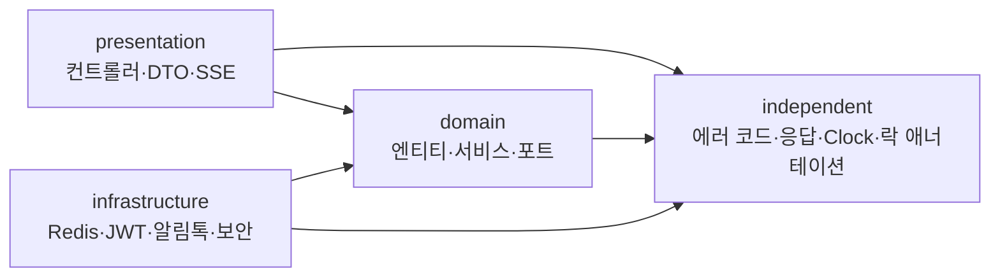
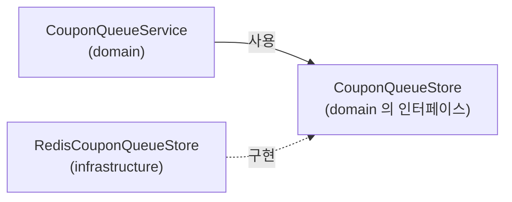
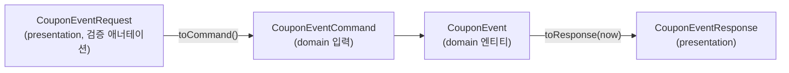

# 3장. 프로젝트 구조와 계층

**한 줄 요약**: 비즈니스 규칙(domain)은 Redis·JWT·알림톡 같은 기술을 모르게 하고, 기술 쪽이 domain 의 인터페이스를 구현하게 합니다. 이 방향을 테스트(ArchUnit)로 강제합니다.

## 1. 왜 계층을 나누나

코드를 "무엇을 하느냐"와 "어떻게 하느냐"로 나누면 바꿀 때 덜 아픕니다.

- "소진되면 더 발급하지 않는다"는 **규칙**입니다. Redis 를 쓰든 다른 저장소를 쓰든 같아야 합니다.
- "Redis ZSET 에 줄을 세운다"는 **기술**입니다. 나중에 Kafka 로 바꿀 수도 있습니다.

둘이 섞여 있으면, 기술을 바꿀 때 규칙 코드까지 고쳐야 하고, 규칙을 테스트하려고 Redis 를 띄워야 합니다.

## 2. 네 개의 패키지



| 패키지 | 들어 있는 것 | 알아도 되는 것 |
|---|---|---|
| `presentation` | 컨트롤러, 요청·응답 DTO, SSE 스트림 | domain, independent |
| `domain` | 엔티티, 리포지토리, 서비스, **포트(인터페이스)** | independent 만 |
| `infrastructure` | 포트를 구현하는 어댑터, Spring 설정 (보안, 비동기, Swagger) | domain, independent |
| `independent` | 에러 코드, 공통 응답, Clock, `@DistributedLock` 애너테이션 | 아무것도 |

화살표는 "import 한다"는 뜻입니다. **domain 에서 나가는 화살표는 independent 하나뿐**입니다.

## 3. 포트와 어댑터 — 의존 방향 뒤집기

domain 은 Redis 가 필요합니다. 그런데 Redis 를 import 하면 안 됩니다. 어떻게 할까요?

**domain 이 "이런 기능이 필요하다"는 인터페이스(포트)를 정하고, infrastructure 가 그것을 구현(어댑터)합니다.** Spring 이 실행할 때 구현을 찾아 넣어 줍니다.



코드의 import 는 `RedisCouponQueueStore → CouponQueueStore` 방향입니다. 실행 흐름(서비스가 Redis 를 부른다)과 **의존 방향이 반대**입니다. 그래서 이 구조를 "의존성 역전"이라고 부릅니다.

### 포트 — domain 이 정한 계약

[CouponQueueStore.kt](../src/main/kotlin/com/site/domain/coupon/queue/port/CouponQueueStore.kt#L5-L29)

```kotlin
/**
 * 선착순 대기열 저장소 포트. 어떤 연산이 "원자적"이어야 하는지가 이 인터페이스의 계약이다.
 *
 * 회원은 대기(waiting) → 처리 중(processing) → 결과(result) 순서로 옮겨 간다.
 * 처리 중에는 lease(만료 시각)가 붙어서, 처리하던 워커가 죽으면 lease 가 지난 뒤 다른 워커가 다시 가져간다.
 */
interface CouponQueueStore {
    /** 결과 확인 → 처리 중 확인 → 마감 확인 → 대기 중 확인 → 순번 발급 → 추가를 원자적으로 한다. */
    fun enqueue(couponEventId: Long, memberId: Long): EnqueueResult

    fun activate(couponEventId: Long)

    fun activeEventIds(): Set<Long>

    fun deactivate(couponEventId: Long)

    /** 대기·처리 중이 모두 비어 있으면 순회 대상에서 뺀다. 빼는 사이에 누가 들어왔다면 다시 넣는다. */
    fun deactivateIfEmpty(couponEventId: Long)

    /** 앞에서부터 count 명을 꺼내 처리 중으로 옮긴다. (원자적 — 한 명을 두 워커가 가져가지 않는다) */
    fun claimNext(
        couponEventId: Long,
        count: Long,
        leaseUntilMillis: Long,
    ): List<Long>
```

인터페이스에는 Redis 단어가 하나도 없습니다. 대신 **"무엇이 원자적이어야 하는가"** 가 계약으로 적혀 있습니다. 어떤 저장소로 바꾸든 이 약속은 지켜야 합니다.

### 어댑터 — 기술로 구현

[RedisCouponQueueStore.kt](../src/main/kotlin/com/site/infrastructure/redis/queue/RedisCouponQueueStore.kt#L26-L30)

```kotlin
@Repository
class RedisCouponQueueStore(
    private val redisTemplate: StringRedisTemplate,
    private val properties: CouponQueueProperties,
) : CouponQueueStore {
```

구현 내용은 [9장](09-redis-queue.md)에서 봅니다.

### 이 프로젝트의 포트 전체

| 포트 (domain) | 어댑터 (infrastructure) | 무엇을 감추나 |
|---|---|---|
| [CouponQueueStore](../src/main/kotlin/com/site/domain/coupon/queue/port/CouponQueueStore.kt) | [RedisCouponQueueStore](../src/main/kotlin/com/site/infrastructure/redis/queue/RedisCouponQueueStore.kt) | Redis ZSET·HASH·Lua |
| [AlimtalkSender](../src/main/kotlin/com/site/domain/notification/port/AlimtalkSender.kt) | [SolapiAlimtalkSender](../src/main/kotlin/com/site/infrastructure/biztalk/SolapiAlimtalkSender.kt), [LoggingAlimtalkSender](../src/main/kotlin/com/site/infrastructure/biztalk/LoggingAlimtalkSender.kt) | Solapi SDK, 실제 발송 여부 |
| [TokenIssuer](../src/main/kotlin/com/site/domain/auth/port/TokenIssuer.kt) | [JwtTokenProvider](../src/main/kotlin/com/site/infrastructure/security/jwt/JwtTokenProvider.kt) | JWT 형식, 서명 키 |
| [RefreshTokenStore](../src/main/kotlin/com/site/domain/auth/port/RefreshTokenStore.kt) | [RedisRefreshTokenStore](../src/main/kotlin/com/site/infrastructure/redis/RedisRefreshTokenStore.kt) | Redis 키 구조, Lua |
| [AccessTokenBlacklist](../src/main/kotlin/com/site/domain/auth/port/AccessTokenBlacklist.kt) | [RedisAccessTokenBlacklist](../src/main/kotlin/com/site/infrastructure/redis/RedisAccessTokenBlacklist.kt) | Redis TTL |

[AuthService.kt](../src/main/kotlin/com/site/domain/auth/service/AuthService.kt#L20-L31) 의 첫 줄 주석이 이 구조의 효과를 요약합니다.

```kotlin
/**
 * 토큰 발급·저장·블랙리스트는 모두 포트(인터페이스)로만 다룬다. JWT 인지, Redis 에 저장하는지는 이 클래스가 모른다.
 */
@Service
@Transactional(readOnly = true)
class AuthService(
    private val memberRepository: MemberRepository,
    private val passwordEncoder: PasswordEncoder,
    private val tokenIssuer: TokenIssuer,
    private val refreshTokenStore: RefreshTokenStore,
    private val accessTokenBlacklist: AccessTokenBlacklist,
) {
```

### 구현을 바꿔 끼우기

포트 덕분에 같은 서비스 코드에 다른 구현을 넣을 수 있습니다.

| 상황 | `AlimtalkSender` 구현 | 어떻게 고르나 |
|---|---|---|
| 운영 | `SolapiAlimtalkSender` (실제 발송) | `biztalk.enabled=true` |
| 로컬 | `LoggingAlimtalkSender` (로그만) | 설정 없음 (기본) |
| 통합 테스트 | `FakeAlimtalkSender` (받은 메시지 기록, 실패 흉내) | `@Primary` + `@TestComponent` |

## 4. 실용적인 타협 — JPA 는 domain 에 있다

엄격하게 하면 엔티티에서 `@Entity` 같은 JPA 애너테이션도 빼야 합니다. 이 프로젝트는 그렇게까지 하지 않았습니다.

- 엔티티와 Spring Data 리포지토리 인터페이스는 domain 에 둔다.
- 포트로 감추는 것은 **"바꿀 가능성이 있거나, 테스트에서 가짜로 바꿔야 하는" 기술**(Redis, JWT, 외부 API)이다.
- JPA 를 다른 영속성 기술로 바꿀 일은 이 프로젝트에서 현실적으로 없다. 대신 엔티티 매핑을 감싸는 별도 모델을 두면 코드가 두 배가 된다.

규칙은 "domain 이 infrastructure·presentation 패키지를 import 하지 않는다"입니다. 프레임워크(Spring, JPA, Micrometer) 자체는 domain 에서 씁니다. [CouponIssueMetrics.kt](../src/main/kotlin/com/site/domain/coupon/service/CouponIssueMetrics.kt) 주석: "Micrometer 는 지표용 파사드(로깅의 SLF4J 같은 것)라서 domain 에서 직접 써도 특정 모니터링 시스템에 묶이지 않는다."

## 5. independent — 모두가 쓰는 것

[AsyncExecutors.kt](../src/main/kotlin/com/site/independent/config/AsyncExecutors.kt)

```kotlin
/**
 * 비동기 실행기 빈 이름. @Async("...") 에 쓰는 이름을 계층 공통 위치에 둬서,
 * domain 이 실행기를 만드는 infrastructure 설정 클래스를 import 하지 않아도 되게 한다.
 */
object AsyncExecutors {
    const val NOTIFICATION = "notificationExecutor"
}
```

domain 의 알림 리스너는 `@Async(AsyncExecutors.NOTIFICATION)` 으로 실행기 이름만 압니다. 스레드 풀을 만드는 코드([AsyncConfig.kt](../src/main/kotlin/com/site/infrastructure/async/AsyncConfig.kt))는 infrastructure 에 있습니다.

같은 이유로 `@DistributedLock` **애너테이션**은 independent 에 있고, 그것을 처리하는 **Aspect**(Redisson 사용)는 infrastructure 에 있습니다. domain 의 서비스는 애너테이션만 붙이고 Redis 를 모릅니다.

| independent 에 있는 것 | 왜 여기 |
|---|---|
| `ErrorCode`, `ServiceException` | domain 이 던지고 presentation·infrastructure 가 응답으로 바꾼다 |
| `SuccessResponse`, `PageResponse` | 모든 컨트롤러의 응답 형식 |
| `ClockConfig` | 모든 계층이 같은 시각 기준을 쓴다 |
| `DistributedLock` (애너테이션) | domain 이 붙이고 infrastructure 가 처리한다 |
| `maskPhoneNumber` | 로그를 남기는 모든 곳 |

## 6. 계층 사이의 데이터 — DTO 와 Command

컨트롤러가 받은 요청 DTO 를 서비스에 그대로 넘기면 domain 이 presentation 의 클래스를 import 하게 됩니다.

[CouponEventCommand.kt](../src/main/kotlin/com/site/domain/coupon/service/CouponEventCommand.kt#L9-L26)

```kotlin
/**
 * 서비스가 받는 입력. 컨트롤러의 요청 DTO 를 그대로 받으면 domain 이 presentation 에 의존하게 되므로
 * domain 쪽에 입력 모델을 따로 두고, 컨트롤러가 DTO → Command 로 변환해서 넘긴다.
 */
data class CouponEventCommand(
    val name: String,
    val discountType: DiscountType,
    val discountValue: Int,
    val totalQuantity: Int,
    val startAt: LocalDateTime,
    val endAt: LocalDateTime,
    val issueMode: CouponIssueMode,
    val couponValidityDays: Int,
) {
    fun toDiscount(): Discount = Discount(type = discountType, value = discountValue)

    fun toPeriod(): EventPeriod = EventPeriod(startAt = startAt, endAt = endAt)
}
```



변환 함수(`toCommand`, `toResponse`)는 모두 presentation 쪽에 확장 함수로 둡니다. 화살표가 presentation → domain 방향으로만 생기게 하려는 것입니다.

## 7. 규칙을 테스트로 강제 — ArchUnit

규칙은 문서에만 있으면 언젠가 깨집니다. 누군가 급하게 domain 에서 infrastructure 의 클래스(예: `RedisCouponQueueStore`)를 import 하면 CI 가 실패하게 했습니다.

[LayerDependencyTest.kt](../src/test/kotlin/com/site/architecture/LayerDependencyTest.kt)

```kotlin
/**
 * 계층 의존 방향을 테스트로 강제한다. 규칙을 어기는 import 가 생기면 CI 에서 깨진다.
 *
 *   presentation ──▶ domain ◀── infrastructure
 *          └──────────┴──────────────┴──▶ independent (계층 공통)
 */
@AnalyzeClasses(packages = ["com.site"], importOptions = [ImportOption.DoNotIncludeTests::class])
class LayerDependencyTest {

    @ArchTest
    fun `domain 은 infrastructure 와 presentation 을 모른다`(classes: JavaClasses) {
        noClasses().that().resideInAPackage("com.site.domain..")
            .should().dependOnClassesThat().resideInAnyPackage("com.site.infrastructure..", "com.site.presentation..")
            .because("Redis·JWT·알림톡 같은 기술은 domain 의 포트(인터페이스)를 infrastructure 가 구현하는 방식으로만 연결한다")
            .check(classes)
    }
```

ArchUnit 은 컴파일된 클래스를 읽어 "어느 클래스가 어느 클래스를 쓰는지"를 검사합니다. 테스트 코드는 검사에서 뺐습니다(`DoNotIncludeTests`).

이 규칙이 막는 것은 **이 프로젝트의 패키지**(`com.site.infrastructure`, `com.site.presentation`)뿐입니다. domain 에서 Redis 라이브러리(`org.springframework.data.redis...`)를 직접 써도 이 테스트는 통과합니다. 규칙 테스트는 적어 둔 것만 지킨다는 점을 기억하세요.

## 8. 이 구조가 생긴 과정

처음부터 이렇지 않았습니다. 커밋 기록에 순서가 남아 있습니다.

| 커밋 | 무엇을 했나 |
|---|---|
| `bd05b67` | domain 이 infrastructure 를 모르도록 포트·어댑터 구조로 의존 방향 반전 |
| `d9347c7` | ArchUnit 으로 계층 의존 규칙 강제 |
| `688e0c3` | 다른 프로젝트 흔적·미사용 코드 제거, 학습용 발급 방식은 테스트 소스로 이동 |

처음엔 domain 서비스가 infrastructure 의 클래스(Redis 대기열 리포지토리, `JwtTokenProvider`, 알림톡 발송기)를 직접 import 했습니다. 기술을 바꾸거나 테스트에서 가짜로 바꾸려면 서비스까지 고쳐야 하는 구조였고, 그래서 포트를 도입했습니다. (`bd05b67` 에서 domain 쪽 `import com.site.infrastructure...` 가 모두 사라졌습니다) **처음부터 완벽한 구조를 만들기보다, 아픈 곳이 보일 때 나누는 것**도 방법입니다.

## 흔한 실수

| 실수 | 결과 | 대신 |
|---|---|---|
| domain 서비스에서 `StringRedisTemplate` 을 직접 쓴다 | 규칙을 테스트하려면 Redis 가 필요해진다. ArchUnit 규칙은 `com.site.infrastructure` 패키지만 막아서 이것은 **잡지 못한다** | 포트를 만들고 infrastructure 에서 구현. 리뷰로 막거나 규칙을 넓힌다 |
| 요청 DTO 를 서비스 파라미터로 받는다 | domain → presentation 의존이 생긴다 | domain 에 Command 를 두고 변환 |
| 필터 클래스에 `@Component` 를 붙인다 | Spring Boot 가 서블릿 필터로도 등록해 두 번 실행된다 | `SecurityConfig` 에서 `new` 로 만들어 넣는다 ([6장](06-auth.md)) |
| 포트에 기술 용어를 넣는다 (`zadd`, `hset`) | 인터페이스가 구현에 묶인다 | "무엇을, 얼마나 원자적으로"만 적는다 |

## 직접 해보기

1. `CouponQueueService` 의 생성자에 `private val redisCouponQueueStore: RedisCouponQueueStore` (infrastructure 클래스)를 추가하고 `./gradlew test --tests '*LayerDependencyTest*'` 의 실패 메시지를 읽어 보세요. 이번엔 `StringRedisTemplate` 을 받아 보세요. 테스트가 깨지나요? 왜 그런가요? (확인 후 되돌리세요)
2. `CouponQueueStore` 를 메모리(`ConcurrentHashMap`)로 구현한 `InMemoryCouponQueueStore` 를 설계해 보세요. 포트 주석의 "원자적" 약속을 지키려면 무엇이 필요한가요? (코드는 쓰지 않아도 됩니다)
3. `independent` 패키지에 있는 클래스 중, 실제로는 한 계층에서만 쓰는 것이 있는지 찾아보세요. 있다면 옮겨야 할까요?

다음 장: [4장. JPA 엔티티를 Kotlin 으로](04-jpa-with-kotlin.md)
