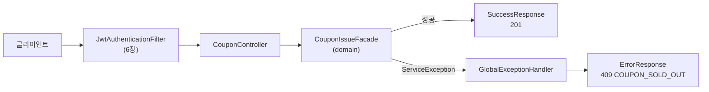

# 5장. 웹 계층과 예외 처리

**한 줄 요약**: 컨트롤러는 얇게 둡니다. 요청을 검증해 domain 입력으로 바꾸고, 결과를 정해진 응답 형식으로 감쌉니다. 실패는 `ErrorCode` 하나로 HTTP 상태·코드·메시지가 함께 정해집니다.

## 1. 요청이 지나가는 길



## 2. 컨트롤러 해부

[CouponController.kt](../src/main/kotlin/com/site/presentation/coupon/api/CouponController.kt#L34-L76)

```kotlin
@RestController
@RequestMapping("/api/coupon-events")
class CouponController(
    private val couponEventService: CouponEventService,
    private val couponIssueFacade: CouponIssueFacade,
    private val couponQueueService: CouponQueueService,
    private val pollingPolicy: CouponQueuePollingPolicy,
    private val queueStreams: CouponQueueStatusStreams,
    private val clock: Clock,
) {

    /** 진행 중·예정 이벤트 (시작이 빠른 순) */
    @GetMapping
    fun getCouponEvents(
        @PageableDefault(size = 20, sort = ["period.startAt"], direction = Sort.Direction.ASC) pageable: Pageable,
    ): ResponseEntity<SuccessResponse<PageResponse<CouponEventSummaryResponse>>> {
        val now = LocalDateTime.now(clock)
        val events = couponEventService.getNotEndedCouponEvents(pageable)
        return SuccessCode.GET_COUPON_EVENTS_SUCCESS.toResponseEntity(events.toPageResponse { it.toSummaryResponse(now) })
    }

    /**
     * 즉시 발급. 사전 검사(메모리 캐시) → 동시 실행 제한 → 설정한 방식(coupon.issue.direct-strategy, 기본 원자적 UPDATE)으로 발급한다.
     * 흐름은 CouponIssueFacade 참고.
     */
    @PostMapping("/{couponEventId}/issue")
    fun issue(
        @PathVariable couponEventId: Long,
        @AuthenticationPrincipal authMember: AuthMember,
    ): ResponseEntity<SuccessResponse<IssuedCouponResponse>> {
        val issuedCoupon = couponIssueFacade.issue(couponEventId, authMember.memberId)
        return SuccessCode.ISSUE_COUPON_SUCCESS.toResponseEntity(issuedCoupon.toResponse())
    }

    /** 대기열 등록. 발급은 나중에 워커가 하므로 "접수됨(202)"으로 응답한다. */
    @PostMapping("/{couponEventId}/queue")
    fun enterQueue(
        @PathVariable couponEventId: Long,
        @AuthenticationPrincipal authMember: AuthMember,
    ): ResponseEntity<SuccessResponse<CouponQueueStatusResponse>> {
        val status = couponQueueService.enqueue(couponEventId, authMember.memberId)
        return SuccessCode.ENTER_COUPON_QUEUE_SUCCESS.toResponseEntity(status.toResponse(pollingPolicy.retryAfterMillis(couponEventId, status)))
    }
```

| 애너테이션 | 하는 일 |
|---|---|
| `@RestController` | 반환값을 JSON 으로 바꿔 응답한다 |
| `@RequestMapping("/api/coupon-events")` | 이 클래스의 공통 경로 |
| `@PostMapping("/{couponEventId}/issue")` | `POST /api/coupon-events/7/issue` |
| `@PathVariable couponEventId: Long` | 경로의 `7` 을 Long 으로. `abc` 가 오면 400 (아래 예외 처리) |
| `@AuthenticationPrincipal authMember: AuthMember` | 로그인한 사용자. JWT 필터가 넣어 둔 값 ([6장](06-auth.md)) |
| `@PageableDefault(...) pageable: Pageable` | `?page=0&size=20&sort=...` 를 객체로. 없으면 기본값 |

컨트롤러는 **판단을 하지 않습니다.** 받은 값을 서비스에 넘기고, 결과를 DTO 로 바꿉니다. 회원 ID 를 요청 본문이 아니라 토큰(`authMember.memberId`)에서 꺼내는 것도 중요합니다. 본문에서 받으면 남의 ID 로 쿠폰을 받을 수 있습니다.

> `issue()` 위의 주석은 원래 "즉시 발급 (분산락 + 사전 검사)" 였습니다. M4 에서 기본 방식을 원자적 UPDATE 로 바꾼 뒤에도 그대로 남아 있다가, 이 교재를 쓰면서 발견해 고쳤습니다(#65). 주석은 코드와 함께 늙습니다. 자세한 흐름은 한 곳(`CouponIssueFacade`)에만 적고 다른 곳은 그곳을 가리키게 하면, 흐름이 바뀔 때 고칠 곳이 하나로 줄어듭니다. ([7장](07-concurrency.md))

## 3. 응답 형식 — 성공은 `SuccessResponse`

모든 성공 응답은 같은 모양입니다.

[SuccessResponse.kt](../src/main/kotlin/com/site/independent/response/SuccessResponse.kt)

```kotlin
data class SuccessResponse<T>(
    val httpStatus: Int,
    val code: String,
    val message: String,
    val data: T,
) {
    companion object {
        fun <T> of(successCode: SuccessCode, data: T): SuccessResponse<T> =
            SuccessResponse(
                httpStatus = successCode.httpStatus,
                code = successCode.code,
                message = successCode.message,
                data = data,
            )
    }
}

fun <T> SuccessCode.toResponseEntity(data: T): ResponseEntity<SuccessResponse<T>> =
    ResponseEntity.status(httpStatus).body(SuccessResponse.of(this, data))

// 돌려줄 데이터가 없는 응답 ("data": null). Nothing? 는 null 하나만 담을 수 있는 타입이다.
fun SuccessCode.toResponseEntity(): ResponseEntity<SuccessResponse<Nothing?>> = toResponseEntity(null)
```

`SuccessCode` 가 상태 코드·코드·메시지를 한 번에 정합니다. ([SuccessCode.kt](../src/main/kotlin/com/site/independent/type/SuccessCode.kt))

```kotlin
    ISSUE_COUPON_SUCCESS(201, "ISSUE_COUPON_SUCCESS", "쿠폰 발급에 성공하였습니다."),
    ENTER_COUPON_QUEUE_SUCCESS(202, "ENTER_COUPON_QUEUE_SUCCESS", "쿠폰 발급 대기열에 등록되었습니다."),
```

즉시 발급은 쿠폰이 만들어졌으니 **201 Created**, 대기열 등록은 "접수만 했고 처리는 나중"이니 **202 Accepted** 입니다. 상태 코드만 봐도 클라이언트가 다음에 할 일(결과를 다시 물어보기)을 압니다.

응답 예 (`// 예시`):

```json
{
  "httpStatus": 201,
  "code": "ISSUE_COUPON_SUCCESS",
  "message": "쿠폰 발급에 성공하였습니다.",
  "data": { "id": 15, "couponEventId": 7, "issuedAt": "2026-10-26T10:00:00.123" }
}
```

### 페이지 응답은 직접 만든 형식으로

[PageResponse.kt](../src/main/kotlin/com/site/independent/response/PageResponse.kt#L5-L16)

```kotlin
/**
 * Spring Data 의 Page 를 그대로 JSON 으로 내보내면 내부 구조가 노출되고 버전마다 형태가 바뀔 수 있다.
 * (Spring Data 3.3+ 는 PageImpl 직렬화 시 경고를 남긴다) 필요한 필드만 담아 고정된 형태로 내보낸다.
 */
data class PageResponse<T>(
    val content: List<T>,
    val page: Int,
    val size: Int,
    val totalElements: Long,
    val totalPages: Int,
    val hasNext: Boolean,
)
```

API 응답은 클라이언트와의 약속입니다. 라이브러리 내부 구조를 그대로 내보내면, 라이브러리 버전을 올릴 때 약속이 몰래 바뀝니다.

## 4. 요청 검증

### Bean Validation 과 `@field:`

[SignUpRequest.kt](../src/main/kotlin/com/site/presentation/member/dto/SignUpRequest.kt#L8-L28)

```kotlin
/**
 * Kotlin 에서 Bean Validation 을 쓸 때는 반드시 @field: 를 붙인다.
 * 안 붙이면 애너테이션이 생성자 파라미터에 붙어서 검증이 조용히 무시된다.
 */
data class SignUpRequest(
    @field:NotBlank
    @field:Email
    @field:Size(max = 100)
    val email: String,

    @field:Size(min = 8, max = 20)
    val password: String,

    @field:NotBlank
    @field:Size(max = 20)
    val nickname: String,

    // 선택 입력: JSON 에 없으면 기본값 null 이 들어간다. (@Pattern 은 null 이면 검사하지 않는다)
    @field:Pattern(regexp = "^01[016789]\\d{7,8}$", message = "휴대폰 번호는 숫자만 10~11자리로 입력해주세요.")
    val phoneNumber: String? = null,
)
```

Kotlin 의 `val email: String` 한 줄은 **생성자 파라미터, 필드, getter** 를 한꺼번에 만듭니다. 애너테이션을 어디에 붙일지 정하지 않으면 생성자 파라미터에 붙고, 검증기는 필드를 보므로 검증이 일어나지 않습니다. **에러도 없이 조용히** 무시된다는 점이 위험합니다. `@field:` 로 필드에 붙입니다.

컨트롤러에서 `@Valid` 를 붙여야 검증이 실행됩니다.

```kotlin
// MemberController.kt
    @PostMapping
    fun signUp(@Valid @RequestBody request: SignUpRequest): ResponseEntity<SuccessResponse<MemberResponse>> {
```

### null 과 기본값 — Kotlin 이 거들어 준다

- `val email: String` (non-null) 인데 JSON 에 `email` 이 없으면? `jackson-module-kotlin` 이 객체를 만들지 못하고 `HttpMessageNotReadableException` 이 납니다. 400 으로 응답합니다(아래).
- `val phoneNumber: String? = null` 은 JSON 에 없으면 기본값 null 이 들어갑니다. **기본값이 있는 파라미터 = 선택 입력**입니다.

[CouponEventRequest.kt](../src/main/kotlin/com/site/presentation/admin/dto/CouponEventRequest.kt#L14-L45)

```kotlin
/**
 * 등록·수정 공용 요청. (수정은 PUT — 전체 필드를 다시 보낸다)
 *
 * 단일 필드 규칙(빈 값, 양수, 길이)은 여기서, 필드 간 규칙(시작 < 종료, 정률은 100% 이하)은
 * 도메인 값 객체(EventPeriod, Discount)가 검사한다.
 */
data class CouponEventRequest(
    @field:NotBlank
    @field:Size(max = 50)
    val name: String,

    val discountType: DiscountType,

    @field:Positive
    val discountValue: Int,

    @field:Positive
    @field:Max(1_000_000)
    val totalQuantity: Int,

    val startAt: LocalDateTime,

    val endAt: LocalDateTime,

    // 생략하면 즉시 발급. 시작 후에는 바꿀 수 없다.
    val issueMode: CouponIssueMode = CouponIssueMode.DIRECT,

    // 발급 후 며칠 동안 쓸 수 있는지. 생략하면 30일
    @field:Min(1)
    @field:Max(365)
    val couponValidityDays: Int = CouponEvent.DEFAULT_COUPON_VALIDITY_DAYS,
)
```

검증을 두 곳에 나눈 기준이 주석에 있습니다.

| 규칙 | 어디서 | 왜 |
|---|---|---|
| 이름이 비었나, 수량이 양수인가 | DTO (`@field:...`) | 필드 하나만 보면 된다. 실패한 필드 목록을 한 번에 돌려줄 수 있다 |
| 시작 < 종료, 정률은 100% 이하 | domain 값 객체 (`init`) | 필드 여러 개를 함께 봐야 한다. 어디서 만들든 지켜져야 하는 규칙이다 |

## 5. 실패는 `ErrorCode` 하나로

[ErrorCode.kt](../src/main/kotlin/com/site/independent/type/ErrorCode.kt#L3-L8)

```kotlin
enum class ErrorCode(
    val httpStatus: Int,
    val code: String,
    val message: String,
) {
    INVALID_INPUT_VALUE(400, "INVALID_INPUT_VALUE", "요청 값이 올바르지 않습니다."),
```

일부만 추리면:

| 코드 | 상태 | 언제 |
|---|---|---|
| `INVALID_INPUT_VALUE` | 400 | 검증 실패, JSON 파싱 실패, 경로 타입 불일치 |
| `QUEUE_ONLY_COUPON_EVENT` | 400 | 대기열 이벤트를 즉시 발급으로 받으려 함 |
| `EXPIRED_TOKEN` / `LOGGED_OUT_TOKEN` | 401 | 토큰 문제 |
| `ROLE_FORBIDDEN` | 403 | 권한 부족 |
| `COUPON_EVENT_NOT_FOUND` | 404 | 없는 이벤트 |
| `COUPON_SOLD_OUT` / `ALREADY_ISSUED_COUPON` | 409 | 지금 상태와 충돌 |
| `LOCK_ACQUISITION_FAILED` | 503 | 요청이 몰려 처리하지 못함. 다시 시도하면 될 수 있다 |

409(Conflict)와 503(Service Unavailable)을 구분한 것이 실용적입니다. 클라이언트는 409 면 "다시 눌러도 소용없다", 503 이면 "잠시 후 다시"라고 안내할 수 있습니다.

domain 은 `ServiceException(ErrorCode.X)` 를 던지기만 합니다.

[ServiceException.kt](../src/main/kotlin/com/site/independent/error/exception/ServiceException.kt)

```kotlin
open class ServiceException(
    val errorCode: ErrorCode,
) : RuntimeException()
```

`RuntimeException` 을 상속하므로 `@Transactional` 메서드에서 던지면 트랜잭션이 롤백됩니다. ([7장](07-concurrency.md))

### 예외를 응답으로 — `@RestControllerAdvice`

[GlobalExceptionHandler.kt](../src/main/kotlin/com/site/independent/error/GlobalExceptionHandler.kt#L16-L41)

```kotlin
@RestControllerAdvice
class GlobalExceptionHandler {

    private val log = LoggerFactory.getLogger(javaClass)

    @ExceptionHandler(ServiceException::class)
    fun handleServiceException(e: ServiceException): ResponseEntity<ErrorResponse> = e.errorCode.toResponseEntity()

    // @Valid 검증 실패 (예: 이메일 형식 오류, 길이 제한 위반)
    @ExceptionHandler(MethodArgumentNotValidException::class)
    fun handleMethodArgumentNotValid(e: MethodArgumentNotValidException): ResponseEntity<ErrorResponse> {
        val errors = e.bindingResult.fieldErrors.map {
            ErrorResponse.FieldErrorDetail(field = it.field, reason = it.defaultMessage.orEmpty())
        }
        return ErrorCode.INVALID_INPUT_VALUE.toResponseEntity(errors)
    }

    // JSON 파싱 실패 (예: non-null 필드 누락 시 jackson-module-kotlin이 여기서 막는다)
    @ExceptionHandler(HttpMessageNotReadableException::class)
    fun handleHttpMessageNotReadable(e: HttpMessageNotReadableException): ResponseEntity<ErrorResponse> =
        ErrorCode.INVALID_INPUT_VALUE.toResponseEntity()

    // 경로/쿼리 파라미터 타입 불일치 (예: /coupon-events/abc)
    @ExceptionHandler(MethodArgumentTypeMismatchException::class)
    fun handleMethodArgumentTypeMismatch(e: MethodArgumentTypeMismatchException): ResponseEntity<ErrorResponse> =
        ErrorCode.INVALID_INPUT_VALUE.toResponseEntity()
```

컨트롤러마다 try-catch 를 쓰지 않고, 예외 종류별로 한 곳에서 응답을 정합니다. 맨 끝의 `@ExceptionHandler(Exception::class)` 는 예상 못 한 예외를 로그로 남기고 500 으로 응답합니다. 내부 에러 메시지를 클라이언트에 그대로 보내지 않습니다.

검증 실패 응답은 어떤 필드가 왜 틀렸는지 담습니다. (`// 예시`)

```json
{
  "httpStatus": 400,
  "code": "INVALID_INPUT_VALUE",
  "message": "요청 값이 올바르지 않습니다.",
  "errors": [{ "field": "email", "reason": "올바른 형식의 이메일 주소여야 합니다" }]
}
```

### 필터 단계의 에러는 여기까지 오지 않는다

JWT 검증은 컨트롤러보다 앞의 **서블릿 필터**에서 일어납니다. `@RestControllerAdvice` 는 컨트롤러에서 난 예외만 잡으므로, 인증·인가 실패 응답은 직접 씁니다.

[ErrorResponseWriter.kt](../src/main/kotlin/com/site/infrastructure/security/handler/ErrorResponseWriter.kt)

```kotlin
/**
 * 필터 단계의 예외는 @RestControllerAdvice 까지 오지 않으므로 응답을 직접 써야 한다.
 * HttpServletResponse 에 확장 함수로 붙여서 response.writeErrorResponse(...) 처럼 호출한다.
 */
fun HttpServletResponse.writeErrorResponse(objectMapper: ObjectMapper, errorCode: ErrorCode) {
    status = errorCode.httpStatus
    contentType = MediaType.APPLICATION_JSON_VALUE
    characterEncoding = Charsets.UTF_8.name()
    objectMapper.writeValue(writer, ErrorResponse.of(errorCode))
}
```

같은 `ErrorResponse` 형식을 써서, 클라이언트 입장에서는 어디서 난 에러든 모양이 같습니다. 흐름은 [6장](06-auth.md)에서 봅니다.

## 6. 엔티티를 그대로 응답하지 않는다

[CouponEventResponse.kt](../src/main/kotlin/com/site/presentation/admin/dto/CouponEventResponse.kt#L26-L43)

```kotlin
// 상태는 시각에 따라 달라지므로 "언제 기준으로" 볼지를 받는다
fun CouponEvent.toResponse(now: LocalDateTime): CouponEventResponse =
    CouponEventResponse(
        id = id,
        name = name,
        discountType = discount.type,
        discountValue = discount.value,
        totalQuantity = totalQuantity,
        issuedQuantity = issuedQuantity,
        remainingQuantity = remainingQuantity,
        startAt = period.startAt,
        endAt = period.endAt,
        status = status(now),
        issueMode = issueMode,
        couponValidityDays = couponValidityDays,
        createdAt = createdAt,
        updatedAt = updatedAt,
    )
```

엔티티를 그대로 JSON 으로 내보내면 내부 필드(예: `version`)까지 나가고, 엔티티를 고칠 때마다 API 가 바뀝니다. DTO 를 두면 API 와 엔티티를 따로 바꿀 수 있습니다. 상태처럼 계산이 필요한 값은 기준 시각(`now`)을 받아 채웁니다.

## 7. API 문서 — Swagger

[SwaggerConfig.kt](../src/main/kotlin/com/site/infrastructure/swagger/SwaggerConfig.kt)

```kotlin
/** http://localhost:8080/swagger-ui/index.html 우측 상단 Authorize 버튼에 accessToken 을 넣으면 된다. */
@Configuration
@OpenAPIDefinition(
    info = Info(title = "Kopring Core API", version = "v1"),
    security = [SecurityRequirement(name = "bearerAuth")],
)
@SecurityScheme(
    name = "bearerAuth",
    type = SecuritySchemeType.HTTP,
    scheme = "bearer",
    bearerFormat = "JWT",
)
class SwaggerConfig
```

springdoc 이 컨트롤러를 읽어 문서를 만듭니다. Kotlin 의 null 여부와 기본값도 반영돼, `String?` 필드는 선택 항목으로 표시됩니다.

## 흔한 실수

| 실수 | 결과 | 대신 |
|---|---|---|
| 검증 애너테이션에 `@field:` 를 빼먹는다 | 검증이 조용히 무시된다 | 항상 `@field:` |
| `@Valid` 를 빼먹는다 | DTO 검증이 실행되지 않는다 | `@Valid @RequestBody` |
| 회원 ID 를 요청 본문으로 받는다 | 남의 ID 로 요청할 수 있다 | 토큰에서 꺼낸 `authMember.memberId` |
| 컨트롤러에서 try-catch 로 에러 응답을 만든다 | 응답 형식이 컨트롤러마다 달라진다 | 예외를 던지고 `GlobalExceptionHandler` 에 맡긴다 |
| `Page<T>` 를 그대로 반환한다 | 라이브러리 내부 구조가 API 가 된다 | `PageResponse` |
| 모든 실패를 400 이나 500 으로 | 클라이언트가 재시도 여부를 판단할 수 없다 | 409(상태 충돌), 503(잠시 후 재시도) 구분 |

## 직접 해보기

1. `SignUpRequest.email` 의 `@field:Email` 을 `@Email` 로 바꾸고 잘못된 이메일로 가입해 보세요. 무슨 일이 일어나나요? (확인 후 되돌리세요)
2. "이벤트 상세 조회"(`GET /api/coupon-events/{id}`) 사용자 API 를 추가한다면, 어떤 `SuccessCode` 와 `ErrorCode` 가 필요할까요? 이미 있는 것을 재사용할 수 있나요?
3. `LOCK_ACQUISITION_FAILED` 응답에 `Retry-After` 헤더를 붙이려면 어디를 고쳐야 할까요?

다음 장: [6장. 인증](06-auth.md)
