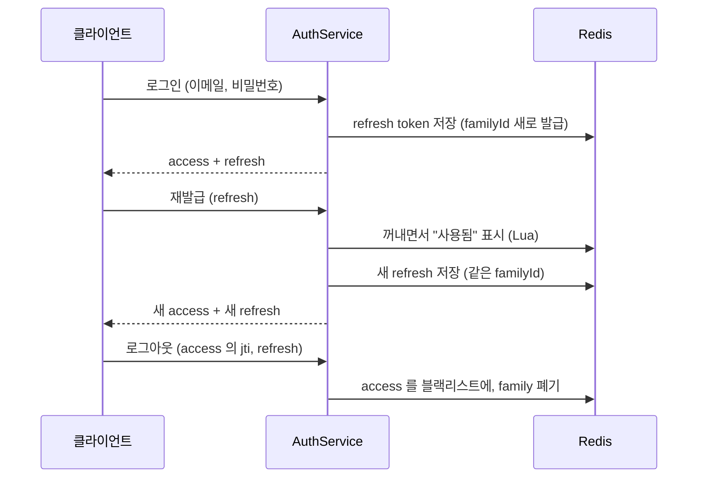
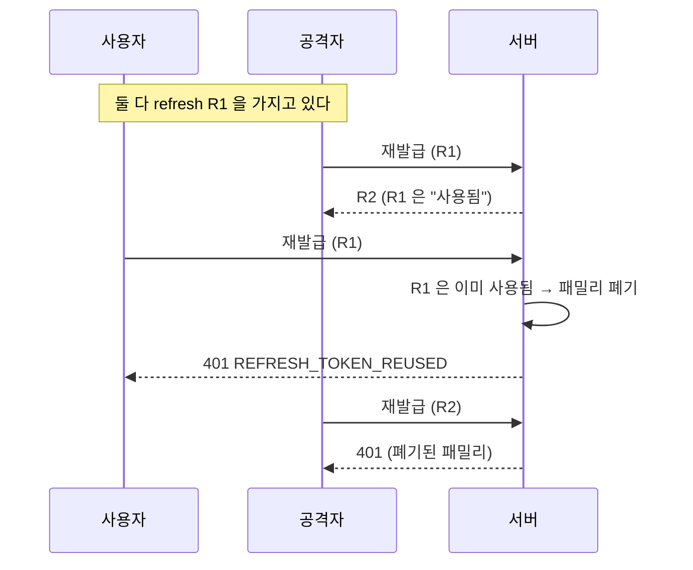

# 6장. 인증 — JWT, Refresh Token Rotation, 블랙리스트

**한 줄 요약**: 짧게 사는 access token(JWT)으로 요청마다 인증하고, 길게 사는 refresh token 은 쓸 때마다 새것으로 바꿉니다. 이미 쓴 refresh token 이 다시 오면 탈취로 보고 그 로그인 전체를 끊습니다.

## 1. 큰 그림

| 토큰 | 형식 | 수명 | 저장 위치 | 하는 일 |
|---|---|---|---|---|
| access token | JWT (서명된 JSON) | 30분 | 서버에 저장 안 함 | 요청마다 `Authorization: Bearer ...` |
| refresh token | 무작위 문자열 | 14일 | Redis (해시로) | access token 이 만료되면 새 쌍을 받는다 |



access token 은 서버에 저장하지 않으니 검증이 빠릅니다(서명과 만료만 확인). 대신 **한 번 발급하면 만료 전에 무를 수 없습니다.** 로그아웃을 위해 블랙리스트를 둡니다.

## 2. Spring Security 설정 — Kotlin DSL

[SecurityConfig.kt](../src/main/kotlin/com/site/infrastructure/security/SecurityConfig.kt#L31-L70)

```kotlin
    /**
     * Spring Security Kotlin DSL.
     * `http { ... }` 는 import org.springframework.security.config.annotation.web.invoke 로 들어오는
     * 확장 함수(operator fun HttpSecurity.invoke)다. 이 import 가 빠지면 컴파일 에러가 난다.
     */
    @Bean
    fun securityFilterChain(http: HttpSecurity): SecurityFilterChain {
        http {
            csrf { disable() }
            httpBasic { disable() }
            formLogin { disable() }
            sessionManagement {
                sessionCreationPolicy = SessionCreationPolicy.STATELESS
            }
            authorizeHttpRequests {
                // SSE 같은 비동기 응답이 끝날 때 한 번 더 일어나는 ASYNC 디스패치. 처음 요청(REQUEST)에서 이미 인가를 통과했다.
                // 막으면 이미 보내기 시작한 응답에 인가 실패가 겹쳐 "response is already committed" 오류가 난다.
                authorize(DispatcherTypeRequestMatcher(DispatcherType.ASYNC), permitAll)
                authorize(HttpMethod.POST, "/api/members", permitAll)
                authorize(HttpMethod.POST, "/api/auth/login", permitAll)
                authorize(HttpMethod.POST, "/api/auth/reissue", permitAll)
                authorize("/swagger-ui/**", permitAll)
                authorize("/v3/api-docs/**", permitAll)
                authorize("/actuator/health", permitAll)
                // Prometheus 수집용. 운영 프로필은 health 만 노출해서 이 경로 자체가 없다 (운영에서 노출하려면 관리 포트를 분리한다)
                authorize("/actuator/prometheus", permitAll)
                authorize("/error", permitAll)
                authorize("/api/admin/**", hasRole("ADMIN"))
                authorize(anyRequest, authenticated)
            }
            exceptionHandling {
                authenticationEntryPoint = jwtAuthenticationEntryPoint
                accessDeniedHandler = jwtAccessDeniedHandler
            }
            addFilterBefore<UsernamePasswordAuthenticationFilter>(
                JwtAuthenticationFilter(jwtTokenProvider, accessTokenBlacklist),
            )
        }
        return http.build()
    }
```

Java 의 `http.csrf(c -> c.disable()).sessionManagement(...)` 사슬을 Kotlin 의 블록 문법으로 쓴 것입니다. 1장에서 본 **확장 함수 + 람다**가 합쳐진 DSL(작은 전용 언어)입니다. `addFilterBefore<UsernamePasswordAuthenticationFilter>(...)` 처럼 타입을 꺾쇠로 넘기는 것도 Kotlin 전용 문법입니다.

| 설정 | 왜 |
|---|---|
| `csrf { disable() }` | 쿠키 세션을 쓰지 않고 헤더 토큰만 쓰므로 CSRF 공격 대상이 아니다 |
| `STATELESS` | 서버가 세션을 만들지 않는다. 인증 정보는 매 요청의 토큰에서 온다 |
| `authorize` 순서 | 위에서부터 처음 맞는 규칙이 적용된다. `anyRequest` 는 맨 끝 |
| `hasRole("ADMIN")` | 권한 이름 `ROLE_ADMIN` 을 가진 사용자만 |
| `DispatcherType.ASYNC` 허용 | SSE 응답이 끝날 때의 내부 재디스패치. [9장](09-redis-queue.md)의 SSE 를 붙이며 추가했다 |

## 3. 요청마다 — `JwtAuthenticationFilter`

[JwtAuthenticationFilter.kt](../src/main/kotlin/com/site/infrastructure/security/jwt/JwtAuthenticationFilter.kt#L15-L51)

```kotlin
/**
 * 토큰이 유효하면 SecurityContext 에 인증 정보를 넣고, 아니면 에러 코드만 request 에 남긴 채 통과시킨다.
 * 실제 401 응답은 인증이 필요한 경로에서 JwtAuthenticationEntryPoint 가 만든다.
 *
 * @Component 로 등록하지 않는다. 빈으로 등록하면 Spring Boot 가 서블릿 필터로도 자동 등록해서
 * Security 필터 체인 밖에서 한 번 더 실행된다.
 */
class JwtAuthenticationFilter(
    private val jwtTokenProvider: JwtTokenProvider,
    private val accessTokenBlacklist: AccessTokenBlacklist,
) : OncePerRequestFilter() {

    override fun doFilterInternal(
        request: HttpServletRequest,
        response: HttpServletResponse,
        filterChain: FilterChain,
    ) {
        resolveToken(request)?.let { token ->
            try {
                val authMember = authenticate(token)
                SecurityContextHolder.getContext().authentication =
                    UsernamePasswordAuthenticationToken(authMember, null, authMember.authorities)
            } catch (e: ServiceException) {
                request.setAttribute(JWT_ERROR_ATTRIBUTE, e.errorCode)
            }
        }

        filterChain.doFilter(request, response)
    }

    private fun authenticate(token: String): AuthMember {
        val authMember = jwtTokenProvider.parseAccessToken(token)
        if (accessTokenBlacklist.contains(authMember.tokenId)) {
            throw ServiceException(ErrorCode.LOGGED_OUT_TOKEN)
        }
        return authMember
    }
```

필터는 **거절하지 않고 기록만 합니다.** 토큰이 없거나 잘못돼도 다음으로 넘깁니다. 왜일까요?

- 로그인·회원가입처럼 토큰 없이 와야 하는 경로가 있다. 그 판단은 `authorize` 규칙이 한다.
- 인증이 필요한 경로에서 인증 정보가 없으면, Spring Security 가 `JwtAuthenticationEntryPoint` 를 부른다. 그때 필터가 남긴 에러 코드(만료? 위조? 로그아웃?)를 꺼내 정확한 이유로 401 을 만든다.

[JwtAuthenticationEntryPoint.kt](../src/main/kotlin/com/site/infrastructure/security/handler/JwtAuthenticationEntryPoint.kt)

```kotlin
        // 필터가 남긴 토큰 에러가 있으면 그걸, 없으면 "토큰 자체가 없음"으로 응답
        val errorCode = request.getAttribute(JwtAuthenticationFilter.JWT_ERROR_ATTRIBUTE) as? ErrorCode
            ?: ErrorCode.EMPTY_AUTHENTICATION
```

`as?` 는 안전한 형변환입니다. 타입이 맞지 않거나 null 이면 null 을 돌려줍니다.

`SecurityContext` 에 넣은 `AuthMember` 가 컨트롤러의 `@AuthenticationPrincipal authMember: AuthMember` 로 나옵니다.

[AuthMember.kt](../src/main/kotlin/com/site/infrastructure/security/AuthMember.kt#L8-L22)

```kotlin
/**
 * SecurityContext 에 담기는 인증 주체.
 * 컨트롤러에서 @AuthenticationPrincipal authMember: AuthMember 로 꺼내 쓴다.
 *
 * tokenId / tokenExpiresAt 은 "어떤 access token 으로 인증됐는지"를 나타낸다. (로그아웃 시 블랙리스트 등록용)
 */
data class AuthMember(
    val memberId: Long,
    val role: MemberRole,
    val tokenId: String,
    val tokenExpiresAt: Instant,
) {
    val authorities: List<GrantedAuthority>
        get() = listOf(SimpleGrantedAuthority(role.authority))
}
```

## 4. 토큰 만들기와 읽기 — `JwtTokenProvider`

[JwtTokenProvider.kt](../src/main/kotlin/com/site/infrastructure/security/jwt/JwtTokenProvider.kt#L33-L70)

```kotlin
    override fun createAccessToken(memberId: Long, role: MemberRole): String {
        val now = Date()
        val expiration = Date(now.time + jwtProperties.accessTokenExpiration.toMillis())

        return Jwts.builder()
            .id(UUID.randomUUID().toString())
            .subject(memberId.toString())
            .claim(ROLE_CLAIM, role.name)
            .issuedAt(now)
            .expiration(expiration)
            .signWith(secretKey)
            .compact()
    }

    /**
     * refresh token 은 JWT 가 아니라 무작위 문자열이다.
     * Redis 에 저장된 값과 대조해야만 의미가 있으므로 토큰 안에 정보를 담을 필요가 없고,
     * 탈취되더라도 안에서 읽어낼 정보가 없다.
     */
    override fun createRefreshToken(): String {
        val bytes = ByteArray(REFRESH_TOKEN_BYTES).also { secureRandom.nextBytes(it) }
        return Base64.getUrlEncoder().withoutPadding().encodeToString(bytes)
    }

    fun parseAccessToken(token: String): AuthMember {
        val claims = try {
            parser.parseSignedClaims(token).payload
        } catch (e: JwtException) {
            throw ServiceException(e.toErrorCode())
        }

        return AuthMember(
            memberId = claims.subject.toLong(),
            role = MemberRole.valueOf(claims.get(ROLE_CLAIM, String::class.java)),
            tokenId = claims.id,
            tokenExpiresAt = claims.expiration.toInstant(),
        )
    }
```

- `.id(UUID...)` 가 토큰마다 고유한 ID(jti)입니다. 로그아웃할 때 이 ID 를 블랙리스트에 올립니다. 토큰 원문 전체를 저장하지 않아도 됩니다.
- 회원 ID 와 권한을 토큰 안에 넣어서, 요청마다 DB 에서 회원을 읽지 않습니다.
- JWT 는 **암호화가 아니라 서명**입니다. 내용은 누구나 읽을 수 있고, 위조만 못 합니다. 비밀 정보를 넣지 않습니다.

## 5. 권한 — Role 로 갈까, 관리자 엔티티를 따로 둘까

관리자를 표현하는 방법은 두 가지였습니다.

| 방식 | 장점 | 단점 |
|---|---|---|
| **회원에 Role 컬럼** (선택) | 로그인·토큰·필터를 그대로 쓴다. `hasRole("ADMIN")` 한 줄 | 관리자만의 정보가 많아지면 회원 테이블이 커진다 |
| 관리자 엔티티 분리 | 관리자 전용 필드·감사 로그를 따로 둔다 | 로그인 경로와 토큰 처리가 두 벌이 된다 |

이 프로젝트는 관리자 기능이 "이벤트 등록·수정"뿐이라 Role 을 택했습니다.

[MemberRole.kt](../src/main/kotlin/com/site/domain/member/entity/MemberRole.kt)

```kotlin
enum class MemberRole {
    USER,
    ADMIN,
    ;

    val authority: String
        get() = "ROLE_$name"
}
```

Spring Security 의 `hasRole("ADMIN")` 은 권한 이름 앞에 `ROLE_` 이 붙어 있기를 기대합니다. 그 규칙을 enum 의 계산 프로퍼티에 한 번만 적었습니다.

관리자 계정은 로컬에서만 코드로 만듭니다. ([LocalAdminInitializer.kt](../src/main/kotlin/com/site/infrastructure/database/LocalAdminInitializer.kt) 주석: "운영에서는 코드로 관리자를 만들지 않는다. DB 에서 role 을 직접 바꾸거나 관리자 초대 기능을 따로 둔다.")

## 6. 로그인 — 같은 에러, 새 토큰 패밀리

[AuthService.kt](../src/main/kotlin/com/site/domain/auth/service/AuthService.kt#L35-L46)

```kotlin
    /**
     * 이메일이 없든 비밀번호가 틀리든 같은 에러를 돌려준다.
     * (어느 쪽이 틀렸는지 알려주면 가입된 이메일을 수집하는 데 악용될 수 있다)
     */
    fun login(email: String, rawPassword: String): TokenPair {
        val member = memberRepository.findByEmail(email)
            ?.takeIf { passwordEncoder.matches(rawPassword, it.password) }
            ?: throw ServiceException(ErrorCode.INVALID_CREDENTIALS)

        // 로그인 한 번 = 새 토큰 패밀리
        return issueTokens(member, familyId = UUID.randomUUID().toString())
    }
```

비밀번호는 `PasswordEncoderFactories.createDelegatingPasswordEncoder()` 로 해시합니다. 저장값이 `{bcrypt}...` 처럼 알고리즘 이름을 달고 있어, 나중에 알고리즘을 바꿔도 기존 비밀번호와 호환됩니다. ([SecurityConfig.kt](../src/main/kotlin/com/site/infrastructure/security/SecurityConfig.kt) 의 `passwordEncoder()` 주석)

## 7. 재발급 — Refresh Token Rotation 과 재사용 감지

refresh token 을 14일 동안 같은 값으로 쓰면, 한 번 훔친 사람이 14일 내내 씁니다. 그래서 **쓸 때마다 새 토큰으로 바꿉니다(rotation).** 그러면 훔친 쪽과 진짜 사용자 중 한쪽은 반드시 "이미 쓴 토큰"을 내밀게 됩니다.

[AuthService.kt](../src/main/kotlin/com/site/domain/auth/service/AuthService.kt#L48-L74)

```kotlin
    /**
     * Refresh Token Rotation (RTR) + 재사용 감지.
     *
     * - 정상: 쓴 토큰은 "사용됨"으로 바뀌고, 같은 패밀리로 새 토큰 쌍을 준다.
     * - 이미 쓴 토큰이 다시 옴: 정상 사용자는 이미 새 토큰을 받았으므로 누군가 훔쳐 쓴 것이다.
     *   패밀리 전체를 폐기해서 공격자와 사용자 모두 다시 로그인하게 한다. (다른 기기의 로그인은 다른 패밀리라 유지)
     * - 폐기된 패밀리의 토큰: 재사용이 감지된 뒤 공격자가 받아 간 새 토큰까지 여기서 막힌다.
     */
    fun reissue(refreshToken: String): TokenPair {
        val owner = when (val result = refreshTokenStore.consume(refreshToken)) {
            is ConsumeResult.Consumed -> result.owner
            is ConsumeResult.Reused -> {
                refreshTokenStore.revokeFamily(result.owner.familyId)
                log.warn("Refresh Token 재사용 감지 — 탈취 의심으로 토큰 패밀리를 폐기합니다. {}", result.owner)
                throw ServiceException(ErrorCode.REFRESH_TOKEN_REUSED)
            }
            ConsumeResult.Invalid -> throw ServiceException(ErrorCode.INVALID_REFRESH_TOKEN)
        }

        if (refreshTokenStore.isFamilyRevoked(owner.familyId)) {
            throw ServiceException(ErrorCode.INVALID_REFRESH_TOKEN)
        }
        val member = memberRepository.findByIdOrNull(owner.memberId)
            ?: throw ServiceException(ErrorCode.INVALID_REFRESH_TOKEN)

        return issueTokens(member, familyId = owner.familyId)
    }
```



**패밀리**는 로그인 한 번에서 이어지는 토큰들의 묶음입니다. 폐기를 패밀리 단위로 하면, 같은 사람이 다른 기기에서 한 로그인은 영향을 받지 않습니다.

### "꺼내기"와 "사용됨 표시"는 원자적이어야 한다

[RefreshTokenStore.kt](../src/main/kotlin/com/site/domain/auth/port/RefreshTokenStore.kt#L14-L18)

```kotlin
    /**
     * 토큰을 꺼내면서 "사용됨"으로 표시한다. 꺼내기와 표시는 원자적이어야 한다.
     * (따로 하면 동시에 들어온 두 요청이 둘 다 "모르는 토큰"으로 판단돼 재사용을 놓칠 수 있다)
     */
    fun consume(refreshToken: String): ConsumeResult
```

Redis 명령 두 개(GET 후 DEL)를 따로 보내면 그 사이에 다른 요청이 끼어듭니다. Redis 는 **Lua 스크립트 하나를 실행하는 동안 다른 명령을 끼워 넣지 않습니다.** 그래서 스크립트로 묶었습니다.

[RedisRefreshTokenStore.kt](../src/main/kotlin/com/site/infrastructure/redis/RedisRefreshTokenStore.kt#L77-L93)

```kotlin
        // KEYS: 토큰 키, 사용됨 키 / ARGV: TTL(초)
        // 아직 안 쓴 토큰이면 꺼내면서 "사용됨"으로 옮기고, 이미 쓴 토큰이면 그 주인을 알려준다.
        private val CONSUME_SCRIPT = DefaultRedisScript(
            """
            local owner = redis.call('GETDEL', KEYS[1])
            if owner then
              redis.call('SET', KEYS[2], owner, 'EX', ARGV[1])
              return 'CONSUMED|' .. owner
            end
            local used = redis.call('GET', KEYS[2])
            if used then
              return 'REUSED|' .. used
            end
            return nil
            """.trimIndent(),
            String::class.java,
        )
```

키 설계도 주석에 있습니다.

[RedisRefreshTokenStore.kt](../src/main/kotlin/com/site/infrastructure/redis/RedisRefreshTokenStore.kt#L13-L21)

```kotlin
/**
 * - refresh-token:{해시}              → "memberId:familyId"  (아직 안 쓴 토큰)
 * - refresh-token:{해시}:used         → "memberId:familyId"  (이미 쓴 토큰 — 재사용 감지용)
 * - refresh-token-family:{familyId}:revoked → "1"           (폐기된 패밀리)
 * 모두 TTL = refresh token 만료 시간.
 *
 * 토큰 원문 대신 SHA-256 해시를 키로 쓴다. Redis 가 유출돼도 키만으로는 토큰을 쓸 수 없다.
 * 중괄호는 Redis Cluster 해시 태그 — 같은 토큰의 두 키가 같은 슬롯에 있어야 Lua 에서 함께 쓸 수 있다.
 */
```

- 비밀번호처럼, 토큰 원문은 저장하지 않고 해시만 저장합니다.
- `{해시}` 의 중괄호는 Redis Cluster 의 **해시 태그**입니다. 클러스터는 키를 여러 서버에 나눠 담는데, 중괄호 안이 같은 키들은 같은 곳에 둡니다. Lua 스크립트는 한 서버 안의 키만 다룰 수 있어서 필요합니다. ([9장](09-redis-queue.md)에서 다시)

## 8. 로그아웃 — 블랙리스트는 원래 만료 시각까지만

[RedisAccessTokenBlacklist.kt](../src/main/kotlin/com/site/infrastructure/redis/RedisAccessTokenBlacklist.kt#L9-L27)

```kotlin
/**
 * access-token:blacklist:{jti} → "logout"
 *
 * 로그아웃한 access token 을 원래 만료 시각까지만 블랙리스트에 둔다.
 * 그 이후에는 어차피 만료 검증에서 걸리므로 TTL 로 Redis 가 알아서 지우게 한다.
 */
@Component
class RedisAccessTokenBlacklist(
    private val redisTemplate: StringRedisTemplate,
) : AccessTokenBlacklist {

    override fun add(tokenId: String, expiresAt: Instant) {
        val ttl = Duration.between(Instant.now(), expiresAt)
        if (ttl.isNegative || ttl.isZero) return

        redisTemplate.opsForValue().set(key(tokenId), LOGOUT_VALUE, ttl)
    }

    override fun contains(tokenId: String): Boolean = redisTemplate.hasKey(key(tokenId)) == true
```

블랙리스트가 무한히 커지지 않는 이유가 TTL 입니다. 30분짜리 토큰이면 최대 30분만 기억합니다.

로그아웃은 refresh token 패밀리도 폐기합니다. 단, **본인 것일 때만** 폐기합니다.

```kotlin
// AuthService.logout
        refreshTokenStore.findOwner(refreshToken)
            ?.takeIf { it.memberId == memberId }
            ?.let { refreshTokenStore.revokeFamily(it.familyId) }
```

남의 refresh token 을 로그아웃 요청에 끼워 넣어 남을 강제로 로그아웃시키는 것을 막습니다.

## 흔한 실수

| 실수 | 결과 | 대신 |
|---|---|---|
| JWT 필터에 `@Component` | 서블릿 필터로도 등록돼 두 번 실행 | `SecurityConfig` 에서 직접 생성 |
| 필터에서 바로 401 을 쓴다 | 공개 경로까지 막거나, 에러 이유가 뭉개진다 | 이유만 기록, 응답은 EntryPoint |
| JWT 에 비밀 정보를 넣는다 | Base64 로 누구나 읽는다 | ID·권한만 |
| refresh token 을 원문으로 저장 | 저장소 유출 = 토큰 유출 | 해시 저장 |
| 꺼내기와 사용됨 표시를 따로 | 동시 요청에서 재사용 감지를 놓친다 | Lua 로 원자적으로 |
| 블랙리스트에 TTL 없음 | 영원히 쌓인다 | 토큰 남은 수명만큼 |
| `import org.springframework.security.config.annotation.web.invoke` 누락 | `http { }` 가 컴파일되지 않는다 | import 확인 |

## 직접 해보기

1. [JwtTokenProviderTest](../src/test/kotlin/com/site/infrastructure/security/jwt/JwtTokenProviderTest.kt) 를 읽고, "role 클레임이 없는 토큰"을 거절하는 테스트를 추가하려면 어떤 결과를 기대해야 할지 정해 보세요. 지금 코드에서는 어떤 예외가 날까요?
2. 같은 refresh token 으로 동시에 재발급 요청 2개가 오면 각각 어떤 응답을 받나요? Lua 스크립트 없이 GET → DEL 로 구현했다면 어떻게 달라질까요?
3. 관리자 기능이 커져서 "관리자별 담당 이벤트" 정보가 필요해졌습니다. Role 방식을 유지하면서 어디에 그 정보를 두면 좋을까요?

다음 장: [7장. 동시성 제어](07-concurrency.md)
