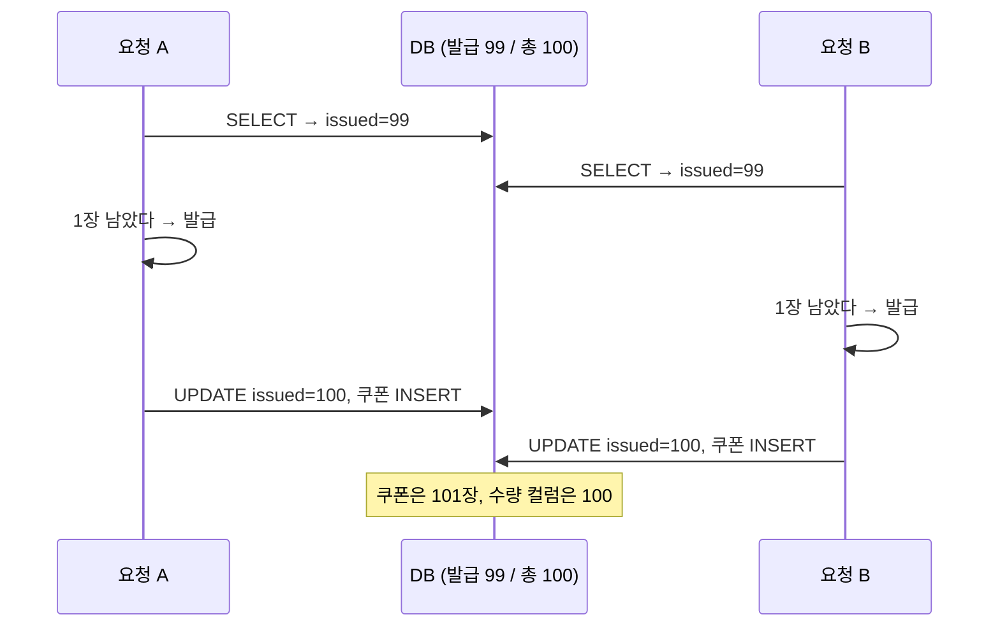
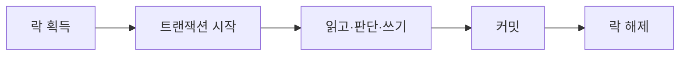
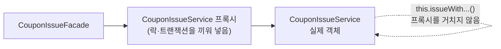
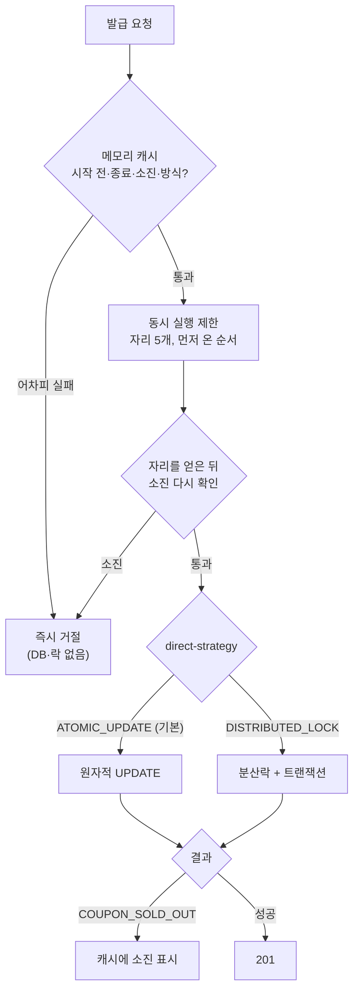

# 7장. 동시성 제어 — 이 프로젝트의 심장

**한 줄 요약**: "읽고 → 판단하고 → 쓰는" 사이에 다른 요청이 끼어들면 쿠폰이 초과 발급됩니다. 그 틈을 막는 방법(락 다섯 가지)은 모두 정확하지만, **어디서 기다리느냐**가 달라 몰릴 때의 속도와 비용이 다릅니다.

## 1. 문제 — Lost Update

[CouponEvent.kt](../src/main/kotlin/com/site/domain/coupon/entity/CouponEvent.kt#L114-L126)

```kotlin
    /**
     * 메모리에서 issuedQuantity 를 quantity 만큼 올린다. (커밋 시점에 dirty checking 으로 UPDATE)
     * "읽고 → 판단하고 → 쓰는" 구조라서, 동시에 여러 요청이 같은 값을 읽으면 Lost Update 가 생긴다.
     * 이 메서드를 안전하게 쓰려면 호출하는 쪽에서 락으로 감싸야 한다. (CouponIssueService 참고)
     */
    fun issue(now: LocalDateTime, quantity: Int = 1) {
        require(quantity > 0) { "quantity must be positive: $quantity" }
        checkIssuable(now)
        if (remainingQuantity < quantity) {
            throw ServiceException(ErrorCode.COUPON_SOLD_OUT)
        }
        issuedQuantity += quantity
    }
```

남은 쿠폰이 1장일 때 두 요청이 동시에 오면:



쿠폰은 101장 나갔고, 수량 컬럼은 B 가 A 의 결과를 덮어써서 100 입니다. 이것이 **Lost Update** 입니다. 테스트로 재현합니다.

[CouponIssueConcurrencyTest.kt](../src/test/kotlin/com/site/domain/coupon/service/CouponIssueConcurrencyTest.kt#L67-L76)

```kotlin
    @Test
    fun `락이 없으면 동시 요청에서 발급 수량이 어긋난다`() {
        val result = issueConcurrently("락 없음", learningStrategies::issueWithoutLock)

        // 타이밍에 따라 결과가 달라지는 문제라 "정확히 몇 장"이 아니라 "정합성이 깨졌는지"를 확인한다.
        // 초과 발급(쿠폰 > 100장) 또는 Lost Update(수량 컬럼 ≠ 실제 발급 건수) 중 하나는 거의 확실하게 일어난다.
        assertTrue(
            result.issuedCouponCount > TOTAL_QUANTITY || result.issuedQuantity.toLong() != result.issuedCouponCount,
        ) { "정합성이 깨지지 않았습니다: $result" }
    }
```

한 번 실행한 로그(실행마다 다릅니다): `락 없음` — 100장짜리 이벤트에 300명이 요청해 **300명 모두 성공, 쿠폰 300장 발급, 수량 컬럼은 30**.

## 2. 해법 다섯 가지

| 방식 | 핵심 | 기다리는 곳 | 이 프로젝트에서 |
|---|---|---|---|
| 락 없음 | — | — | 테스트 전용 (비교용) |
| 비관적 락 | `SELECT ... FOR UPDATE` | DB 행 잠금 (커넥션을 쥔 채) | 대기열 일괄 발급 |
| 분산락 | Redis 락을 먼저 잡는다 | Redis (커넥션 안 씀) | 즉시 발급 선택지 |
| 원자적 UPDATE | `UPDATE ... WHERE 남아 있으면` | DB 행 잠금 (짧게) | 즉시 발급 기본값 |
| 낙관적 락 | `@Version`, 충돌하면 실패 | 기다리지 않는다 | 쿠폰 사용 |

"락 없음"과 비관적 락의 원래 구현은 운영 코드에서 테스트 소스로 옮겼습니다.

[CouponIssueService.kt](../src/main/kotlin/com/site/domain/coupon/service/CouponIssueService.kt#L28-L29)

```kotlin
 * 3단계에서 함께 비교했던 "락 없음", "비관적 락" 방식은 운영 코드에서 빼서 테스트 소스
 * (LearningCouponIssueStrategies)로 옮겼다. 운영 코드에 두면 누군가 락 없는 버전을 호출해 초과 발급이 날 수 있다.
```

### 2-1. 비관적 락 — 행을 잠그고 줄 세우기

[LearningCouponIssueStrategies.kt](../src/test/kotlin/com/site/support/LearningCouponIssueStrategies.kt#L36-L47)

```kotlin
    /**
     * 비관적 락 — SELECT ... FOR UPDATE 로 이벤트 행을 잠근다.
     * 같은 이벤트에 대한 요청은 DB 에서 한 줄로 서서 하나씩 처리된다.
     * 가장 단순하지만, 기다리는 동안에도 DB 커넥션을 붙잡고 있어서 요청이 몰리면 커넥션 풀이 먼저 바닥난다.
     */
    @Transactional
    fun issueWithPessimisticLock(couponEventId: Long, memberId: Long): IssuedCoupon =
        issue(find(couponEventId, LockModeType.PESSIMISTIC_WRITE), memberId)

    private fun find(couponEventId: Long, lockMode: LockModeType): CouponEvent =
        entityManager.find(CouponEvent::class.java, couponEventId, lockMode)
            ?: throw ServiceException(ErrorCode.COUPON_EVENT_NOT_FOUND)
```

먼저 잠근 요청이 커밋할 때까지 다른 요청은 SELECT 에서 멈춥니다. 정확하지만 **기다리는 요청마다 DB 커넥션 하나**를 차지합니다. 커넥션 풀은 기본 10개입니다.

### 2-2. 분산락 — DB 밖에서 줄 세우기

Redis 에 "coupon-event:7 락"을 잡은 요청만 DB 에 들어갑니다. 기다림이 Redis 에서 일어나 DB 커넥션을 쓰지 않습니다.

[CouponIssueService.kt](../src/main/kotlin/com/site/domain/coupon/service/CouponIssueService.kt#L43-L53)

```kotlin
    /**
     * 즉시 발급: 분산락 — Redis 락을 먼저 잡고, 그 안에서 트랜잭션을 열어 커밋한 뒤 락을 푼다.
     * 기다리는 건 Redis 에서 하므로 DB 커넥션을 붙잡지 않고, 서버가 여러 대여도 동작한다.
     * 대신 Redis 라는 의존성이 하나 늘고, 락 획득/해제만큼 왕복 시간이 추가된다.
     */
    @DistributedLock(key = "'coupon-event:' + #couponEventId")
    fun issueWithDistributedLock(couponEventId: Long, memberId: Long): IssuedCoupon {
        val couponEvent = findCouponEvent(couponEventId)
        couponEvent.checkIssueMode(CouponIssueMode.DIRECT)
        return issue(couponEvent, memberId)
    }
```

메서드 본문에는 락 코드가 없습니다. `@DistributedLock` 애너테이션을 보고 **AOP**(Aspect)가 앞뒤에 락을 끼워 넣습니다.

[DistributedLockAspect.kt](../src/main/kotlin/com/site/infrastructure/redis/lock/DistributedLockAspect.kt#L19-L62)

```kotlin
/**
 * @DistributedLock 이 붙은 메서드를 Redisson 락으로 감싼다.
 *
 * 순서: 트랜잭션 인터셉터(기본 LOWEST_PRECEDENCE)보다 한 칸 바깥에서 실행되게 한다.
 * 트랜잭션 프록시가 락보다 바깥에 있으면 "트랜잭션 시작 → 락 → 해제 → 커밋" 순서가 되어 락이 의미를 잃는다.
 *
 * HIGHEST_PRECEDENCE 를 쓰면 안 된다. 스프링 내부의 ExposeInvocationInterceptor 보다 앞서 실행돼서
 * @annotation(distributedLock) 같은 파라미터 바인딩이 실패한다. ("JoinPointMatch was NOT bound in invocation")
 */
@Aspect
@Component
@Order(Ordered.LOWEST_PRECEDENCE - 1)
class DistributedLockAspect(
    private val redissonClient: RedissonClient,
    private val newTransactionRunner: NewTransactionRunner,
    private val meterRegistry: MeterRegistry,
) {

    @Around("@annotation(distributedLock)")
    fun lock(joinPoint: ProceedingJoinPoint, distributedLock: DistributedLock): Any? {
        val lockName = LOCK_PREFIX + resolveKey(joinPoint, distributedLock.key)
        val lock = redissonClient.getLock(lockName)

        val waitStartedAt = System.nanoTime()
        val acquired = try {
            lock.tryLock(distributedLock.waitTime, distributedLock.leaseTime, distributedLock.timeUnit)
        } catch (e: InterruptedException) {
            Thread.currentThread().interrupt()
            throw ServiceException(ErrorCode.LOCK_ACQUISITION_FAILED)
        }
        recordWait(distributedLock.key, acquired, System.nanoTime() - waitStartedAt)
        if (!acquired) {
            throw ServiceException(ErrorCode.LOCK_ACQUISITION_FAILED)
        }

        try {
            return newTransactionRunner.proceed(joinPoint)
        } finally {
            // 락을 쥔 스레드만 풀 수 있다. (다른 스레드가 풀려고 하면 Redisson 이 예외를 던진다)
            if (lock.isHeldByCurrentThread) {
                lock.unlock()
            }
        }
    }
```

여기에 이 장에서 가장 중요한 교훈이 있습니다. **순서**입니다.



락을 커밋보다 **먼저** 풀면, 다음 요청이 락을 잡고 DB 를 읽을 때 앞 요청의 변경이 아직 커밋 전이라 옛 값을 읽습니다. 락을 걸었는데도 Lost Update 가 납니다. 그래서:

1. `@Order(Ordered.LOWEST_PRECEDENCE - 1)`: Spring 의 트랜잭션 인터셉터(기본 `LOWEST_PRECEDENCE`)보다 바깥에서 실행한다. 바깥 = 먼저 시작, 나중에 끝.
2. `HIGHEST_PRECEDENCE` 는 안 된다: 실제로 써 봤다가 `@annotation(distributedLock)` 파라미터 바인딩이 깨지는 에러를 만났다. 주석에 그 에러 메시지가 남아 있다.
3. 트랜잭션은 Aspect 가 직접 연다. 그것도 **항상 새로**.

[NewTransactionRunner.kt](../src/main/kotlin/com/site/infrastructure/redis/lock/NewTransactionRunner.kt#L8-L21)

```kotlin
/**
 * 락 안에서 실행할 로직을 "항상 새로운" 트랜잭션으로 실행한다.
 *
 * REQUIRED(기본값)였다면 호출한 쪽에 이미 트랜잭션이 있을 때 거기에 합류해 버린다.
 * 그러면 커밋이 바깥 트랜잭션이 끝날 때(= 락을 푼 뒤)로 밀려서, 다음 요청이 커밋 전의 옛 값을 읽게 된다.
 *
 * @Transactional 은 프록시를 통해야 동작하므로 Aspect 안에 메서드로 두지 않고 별도 빈으로 분리했다. (self-invocation 문제)
 */
@Component
class NewTransactionRunner {

    @Transactional(propagation = Propagation.REQUIRES_NEW)
    fun proceed(joinPoint: ProceedingJoinPoint): Any? = joinPoint.proceed()
}
```

`leaseTime = -1` 의 의미도 애너테이션 주석에 있습니다. ([DistributedLock.kt](../src/main/kotlin/com/site/independent/lock/DistributedLock.kt): "-1 이면 Redisson watchdog 이 작업이 끝날 때까지 만료를 계속 연장한다. 고정값을 주면 작업이 그보다 오래 걸릴 때 락이 먼저 풀려 버려 동시성 제어가 깨질 수 있다.")

### 2-3. 원자적 UPDATE — DB 가 한 문장으로 판단

읽고 판단하는 일을 애플리케이션이 하지 않고, **UPDATE 한 문장의 조건절**에 넣습니다.

[CouponEventRepository.kt](../src/main/kotlin/com/site/domain/coupon/repository/CouponEventRepository.kt#L35-L51)

```kotlin
    @Modifying
    @Query(
        """
        update CouponEvent e
           set e.issuedQuantity = e.issuedQuantity + 1
         where e.id = :id
           and e.issueMode = :mode
           and e.issuedQuantity < e.totalQuantity
           and e.period.startAt <= :now
           and e.period.endAt > :now
        """,
    )
    fun increaseIssuedQuantity(
        id: Long,
        mode: CouponIssueMode,
        now: LocalDateTime,
    ): Int
```

DB 는 이 UPDATE 를 실행하는 동안 행을 잠급니다. 두 번째 요청은 첫 번째가 커밋할 때까지 기다렸다가, **커밋된 최신 값**으로 조건을 다시 봅니다. 반환값(바뀐 행 수)이 0 이면 소진입니다.

[CouponIssueService.kt](../src/main/kotlin/com/site/domain/coupon/service/CouponIssueService.kt#L55-L84)

```kotlin
    /**
     * 원자적 조건부 UPDATE — 애플리케이션이 값을 읽고 판단하는 대신,
     * "남아 있으면 +1"을 DB 가 UPDATE 한 문장 안에서 처리한다. 읽은 값과 쓰는 값 사이에 틈이 없다.
     * 대신 발급 조건이 엔티티(CouponEvent.checkIssuable)와 쿼리 두 곳에 나뉘어 들어간다.
     *
     * UPDATE 는 커밋까지 이벤트 행 잠금을 쥔다. 모든 발급이 이 한 행에 줄을 서므로, 잠근 뒤 커밋까지 할 일을 줄였다.
     * - 이벤트 조회와 중복 발급 확인은 잠그기 전에 한다. 기간·방식·유효기간은 시작 후 바뀌지 않아 미리 읽어도 된다.
     * - 발급 내역 INSERT 를 UPDATE 보다 먼저 하면 잠금 구간이 더 줄지만, 같은 회원의 요청이 셋 이상 겹친 채 앞 요청이 롤백되면
     *   unique 키 잠금끼리 데드락이 날 수 있다. UPDATE 를 먼저 해서 같은 이벤트의 INSERT 가 항상 차례로 일어나게 했다.
     */
    @Transactional
    fun issueWithAtomicUpdate(
        couponEventId: Long,
        memberId: Long,
        mode: CouponIssueMode,
    ): IssuedCoupon {
        val now = now()
        val couponEvent = findCouponEvent(couponEventId)
        couponEvent.checkIssueMode(mode)
        // 여기서 읽은 수량은 곧 낡지만, "이미 소진"이라면 되돌아가지 않으므로 바로 거절해도 된다
        couponEvent.checkIssuable(now)
        checkNotIssued(couponEventId, memberId)

        if (couponEventRepository.increaseIssuedQuantity(couponEventId, mode, now) == 0) {
            // 방식·기간은 같은 now 로 위에서 확인했으므로 남은 이유는 소진뿐이다
            throw ServiceException(ErrorCode.COUPON_SOLD_OUT)
        }
        // UPDATE 는 영속성 컨텍스트를 거치지 않으므로 couponEvent 의 수량은 낡은 값이다. 유효기간만 쓴다
        return saveIssuedCoupon(couponEvent, memberId)
    }
```

주석의 판단을 풀어 봅니다.

- **잠금 구간 줄이기**: 모든 발급이 이벤트 행 하나에 줄을 섭니다. 행을 잠근 뒤(UPDATE) 커밋까지가 짧을수록 다음 사람이 빨리 들어갑니다. 그래서 잠그지 않아도 되는 읽기(이벤트 조회, 중복 확인)는 UPDATE 전에 합니다.
- **INSERT 를 더 앞으로 당기지 않은 이유**: 발급 내역 INSERT 를 UPDATE 보다 먼저 하면 잠금 구간이 더 줄지만, 같은 회원의 요청 셋이 unique 키에서 엉키면 데드락이 날 수 있습니다. 빠름보다 안전을 골랐습니다.
- **"이미 소진"은 되돌아가지 않는다**: 발급 취소 기능이 없으므로, 한 번 소진이면 영원히 소진입니다. 그래서 잠그지 않고 읽은(곧 낡을) 값으로도 "소진"이면 바로 거절해도 안전합니다. 반대로 "남아 있음"은 믿지 않고 UPDATE 로 다시 확인합니다.

### 2-4. 낙관적 락 — 충돌이 드물면 잠그지 않는다

쿠폰 **사용**은 "한 사람이 자기 쿠폰 한 장을 쓰는" 일이라 충돌이 거의 없습니다. 매번 잠그는 대신, 바꿀 때 "내가 읽은 버전 그대로인가"만 확인합니다.

```kotlin
// IssuedCoupon.kt
    @Version
    var version: Long = 0L
        protected set
```

[CouponWalletService.kt](../src/main/kotlin/com/site/domain/coupon/service/CouponWalletService.kt#L39-L62)

```kotlin
    /**
     * 쿠폰을 쓴다. 같은 쿠폰으로 동시에 두 번 요청하면 먼저 커밋한 쪽만 성공한다. (낙관적 락)
     *
     * saveAndFlush 로 이 메서드 안에서 UPDATE 를 실행시킨다. 커밋 시점까지 미루면 버전 충돌 예외가
     * 메서드가 끝난 뒤(트랜잭션 프록시)에서 터져서 "이미 사용한 쿠폰"으로 바꿔 줄 수 없다.
     */
    @Transactional
    fun use(
        memberId: Long,
        issuedCouponId: Long,
        orderAmount: Int,
    ): CouponUsage {
        val coupon = issuedCouponRepository.findByIdOrNull(issuedCouponId)
            ?.takeIf { it.isOwnedBy(memberId) } // 남의 쿠폰은 "없는 쿠폰"으로 응답한다 (존재 여부를 알려주지 않는다)
            ?: throw ServiceException(ErrorCode.ISSUED_COUPON_NOT_FOUND)
        val couponEvent = couponEventRepository.findByIdOrNull(coupon.couponEventId)
            ?: throw ServiceException(ErrorCode.COUPON_EVENT_NOT_FOUND)

        val discountAmount = coupon.use(orderAmount, couponEvent.discount, LocalDateTime.now(clock))
        try {
            issuedCouponRepository.saveAndFlush(coupon)
        } catch (e: ObjectOptimisticLockingFailureException) {
            throw ServiceException(ErrorCode.ALREADY_USED_COUPON)
        }
```

Hibernate 는 `UPDATE issued_coupon SET ..., version = 1 WHERE id = ? AND version = 0` 을 보냅니다. 0건이면 누가 먼저 바꾼 것이므로 예외를 냅니다.

**선착순 발급에 낙관적 락을 쓰지 않은 이유**: 오픈 순간에는 모든 요청이 같은 행을 바꿉니다. 충돌이 "드물지 않고 항상" 일어나서, 대부분이 실패하고 재시도하게 됩니다.

## 3. `@Transactional` 이 동작하는 방식 — 프록시와 self-invocation

`@Transactional`, `@DistributedLock`, `@Async` 는 모두 **프록시**가 처리합니다.



밖에서 부르면 프록시를 지나가지만, **같은 클래스 안에서 `this.메서드()` 로 부르면 프록시를 건너뜁니다.** 애너테이션이 조용히 무시됩니다. 이 프로젝트가 클래스를 나눈 이유 두 곳이 이것입니다.

[CouponIssueFacade.kt](../src/main/kotlin/com/site/domain/coupon/service/CouponIssueFacade.kt#L21-L22)

```kotlin
 * 왜 CouponIssueService 안에 두지 않았나: 같은 클래스 안에서 issueWithDistributedLock 을 부르면
 * 프록시를 거치지 않아(self-invocation) @DistributedLock 이 동작하지 않는다.
```

`NewTransactionRunner` 가 Aspect 와 따로 있는 것도 같은 이유입니다(위 인용).

### 전파(propagation) — 트랜잭션 안에서 트랜잭션을 부르면

| 전파 | 바깥에 트랜잭션이 있으면 | 없으면 | 이 프로젝트에서 |
|---|---|---|---|
| `REQUIRED` (기본) | 합류한다 | 새로 연다 | 대부분의 서비스 |
| `REQUIRES_NEW` | 바깥을 잠시 멈추고 새로 연다 | 새로 연다 | 분산락 안쪽 (`NewTransactionRunner`) |
| `MANDATORY` | 합류한다 | **예외** | Outbox 기록 ([8장](08-async-and-reliability.md)) |

롤백 규칙: 기본적으로 `RuntimeException` 이 메서드 밖으로 나가면 롤백합니다. `ServiceException` 은 `RuntimeException` 이므로, 발급 중 `ALREADY_ISSUED_COUPON` 이 나면 앞서 올린 수량도 함께 되돌아갑니다.

[CouponIssueService.kt](../src/main/kotlin/com/site/domain/coupon/service/CouponIssueService.kt#L142-L143)

```kotlin
    // 같은 회원의 동시 요청이 checkNotIssued 를 함께 통과해도 unique 제약이 막는다.
    // 예외가 나면 트랜잭션 전체가 롤백되므로 올려둔 issuedQuantity 도 함께 되돌아간다.
```

`readOnly = true` 는 "이 트랜잭션은 읽기만 한다"는 표시입니다. Hibernate 가 변경 감지를 위한 스냅샷을 만들지 않아 가볍습니다. 서비스 클래스에 `@Transactional(readOnly = true)` 를 붙이고, 쓰는 메서드에만 `@Transactional` 을 다시 붙이는 패턴을 씁니다. ([CouponEventService.kt](../src/main/kotlin/com/site/domain/coupon/service/CouponEventService.kt))

`CouponIssueService` 는 예외입니다. 클래스에 `@Transactional` 을 붙이면 분산락 메서드까지 트랜잭션이 바깥에 생겨 2-2 의 순서가 깨집니다. 그래서 메서드마다 붙였습니다. (클래스 주석: "분산락 메서드 때문에 클래스 레벨 @Transactional 을 두지 않고, 메서드마다 붙였다.")

## 4. 마지막 방어선 — unique 제약

같은 회원이 버튼을 연타하면, 두 요청이 "아직 안 받았음" 확인(`checkNotIssued`)을 동시에 통과할 수 있습니다. 이때는 DB 의 `(coupon_event_id, member_id)` unique 제약이 막습니다.

[CouponIssueConcurrencyTest.kt](../src/test/kotlin/com/site/domain/coupon/service/CouponIssueConcurrencyTest.kt#L199-L212)

```kotlin
    @Test
    fun `같은 회원이 동시에 여러 번 요청하면 unique 제약으로 1장만 발급되고, 실패한 요청의 수량 증가는 롤백된다`() {
        val result = issueConcurrently(
            label = "같은 회원 중복 요청",
            issue = ::issueWithAtomicUpdate,
            requestCount = 20,
            memberIdOf = { SAME_MEMBER_ID },
        )

        assertEquals(1, result.successCount)
        assertEquals(1L, result.issuedCouponCount)
        assertEquals(1, result.issuedQuantity)
        assertEquals(mapOf("ALREADY_ISSUED_COUPON" to 19), result.failReasons)
    }
```

애플리케이션 검사는 **빠른 실패**를 위한 것이고, 정합성은 DB 제약이 지킵니다. 두 겹으로 둡니다.

## 5. 앞단의 빠른 거절 — 사전 검사(fast-fail)

락이 정확해도 문제가 남습니다. 쿠폰 100장이 다 나간 뒤에 온 1,900명도 **락 앞에 줄을 서서** "소진" 응답을 받으려고 기다립니다. 어차피 실패할 요청이 앞사람의 차례를 늦춥니다.

[CouponIssueFacade.kt](../src/main/kotlin/com/site/domain/coupon/service/CouponIssueFacade.kt#L9-L51)

```kotlin
/**
 * 즉시 발급의 입구. 빠른 거절(fast-fail) → 설정한 방식으로 발급.
 *
 * 빠른 거절이 없으면 쿠폰이 소진된 뒤에도 나머지 요청이 전부 락(또는 행 잠금) 앞에 줄을 서서 "소진" 응답을 기다린다.
 * 시작 전·종료·소진·방식 불일치처럼 "어차피 실패할 요청"을 메모리 캐시만 보고 먼저 돌려보낸다. (DB 를 읽지 않는다)
 * 이미 받은 회원인지는 여기서 보지 않는다. 회원마다 DB 를 읽어야 하는데, 같은 회원이 다시 요청하는 일은 드물다.
 *
 * 사전 검사를 통과한 요청만 발급 단계의 동시 실행 제한(CouponIssueBulkhead)을 거친다. 소진 뒤 요청은 자리를 기다리지 않는다.
 * 자리를 얻은 뒤에도 한 번 더 확인한다. 줄을 서 있는 사이에 소진되면, 남은 줄이 자리마다 DB 를 한 번씩 거치며 천천히 빠지기 때문이다.
 *
 * 사전 검사는 최적화일 뿐 정합성은 여전히 발급 단계의 검사가 책임진다. (Double-Checked)
 *
 * 왜 CouponIssueService 안에 두지 않았나: 같은 클래스 안에서 issueWithDistributedLock 을 부르면
 * 프록시를 거치지 않아(self-invocation) @DistributedLock 이 동작하지 않는다.
 */
@Service
class CouponIssueFacade(
    private val startedCouponEvents: StartedCouponEventCache,
    private val couponIssueService: CouponIssueService,
    private val bulkhead: CouponIssueBulkhead,
    private val properties: CouponIssueProperties,
    private val metrics: CouponIssueMetrics,
) {

    fun issue(couponEventId: Long, memberId: Long): IssuedCoupon =
        try {
            startedCouponEvents.checkIssuable(couponEventId, CouponIssueMode.DIRECT)
            bulkhead.execute {
                // 자리를 기다리는 사이에 소진됐을 수 있다. 메모리에서 다시 확인해, 소진 뒤 줄은 DB 를 거치지 않고 바로 빠지게 한다
                startedCouponEvents.checkIssuable(couponEventId, CouponIssueMode.DIRECT)
                when (properties.directStrategy) {
                    DirectIssueStrategy.ATOMIC_UPDATE -> couponIssueService.issueWithAtomicUpdate(couponEventId, memberId, CouponIssueMode.DIRECT)
                    DirectIssueStrategy.DISTRIBUTED_LOCK -> couponIssueService.issueWithDistributedLock(couponEventId, memberId)
                }
            }.also { metrics.recordDirectIssued() }
        } catch (e: ServiceException) {
            if (e.errorCode == ErrorCode.COUPON_SOLD_OUT) {
                startedCouponEvents.markSoldOut(couponEventId)
            }
            metrics.recordDirectFailed(e.errorCode)
            throw e
        }
}
```



가운데의 **동시 실행 제한(bulkhead)** 은 M5 에서 더해졌습니다. 원자적 UPDATE 는 행 잠금을 기다리는 동안 DB 커넥션을 쥐므로, 발급이 커넥션을 최대 5개까지만 쓰게 해서 같은 풀을 쓰는 다른 API 의 몫을 남깁니다. 자리를 기다리는 사이에 소진될 수 있어서, 자리를 얻은 뒤 캐시를 한 번 더 봅니다. 왜 필요했고 어떻게 확인했는지는 [13장](13-virtual-threads-and-backpressure.md)에 있습니다.

### 사전 검사는 왜 DB 를 읽지 않아도 되나

[StartedCouponEventCache.kt](../src/main/kotlin/com/site/domain/coupon/service/StartedCouponEventCache.kt#L18-L55)

```kotlin
/**
 * 발급 요청의 빠른 거절(fast-fail)을 DB 없이 하기 위한 캐시. 즉시 발급과 대기열 줄 서기가 함께 쓴다.
 *
 * - 시작된 이벤트는 수정·삭제가 막혀 있으므로(2단계 규칙) 발급 방식과 기간은 바뀔 일이 없다. 처음 한 번만 DB 에서 읽는다.
 *   시작 전 이벤트는 아직 바뀔 수 있으므로 캐시하지 않는다.
 * - 소진은 한 번 확인되면 되돌아가지 않는다. (발급 취소가 없다) 그래서 소진을 본 뒤로는 DB 를 묻지 않고 바로 거절한다.
 *
 * 서버마다 따로 가지는 캐시다. 다른 서버가 먼저 소진을 봤더라도 이 서버는 스스로 한 번 보기 전까지 모를 뿐이고,
 * 그 사이 요청은 발급 단계(락 안 검사, 원자적 UPDATE)에서 거절되므로 정합성에는 영향이 없다.
 */
@Component
class StartedCouponEventCache(
    private val couponEventRepository: CouponEventRepository,
    private val clock: Clock,
) {

    private val events = ConcurrentHashMap<Long, StartedCouponEvent>()

    /** 지금 DB 에서 읽고 있는 이벤트. 같은 이벤트를 읽으려는 다른 요청은 새로 읽지 않고 이 결과를 기다린다 */
    private val loading = ConcurrentHashMap<Long, CompletableFuture<StartedCouponEvent>>()

    /** 지금 [mode] 방식으로 발급을 시도해도 되는지 확인한다. 통과해도 발급이 보장되지는 않는다. */
    fun checkIssuable(couponEventId: Long, mode: CouponIssueMode) {
        val now = LocalDateTime.now(clock)
        val event = events[couponEventId] ?: loadOnce(couponEventId, now)

        event.issueMode.checkRequested(mode)
        val status = event.status(now)
        if (status == CouponEventStatus.ENDED) {
            events.remove(couponEventId)
        }
        status.checkIssuable()
    }

    /** 발급 단계에서 소진을 확인했을 때 부른다. 이후 이 이벤트의 요청은 DB 를 거치지 않고 거절된다. */
    fun markSoldOut(couponEventId: Long) {
        events.computeIfPresent(couponEventId) { _, event -> event.copy(soldOut = true) }
    }
```

캐시가 안전한 이유는 **도메인 규칙**에서 나옵니다.

| 캐시하는 것 | 왜 낡지 않나 |
|---|---|
| 발급 방식, 기간 | 시작된 이벤트는 수정할 수 없다 (`checkModifiable`, 4장) |
| 소진 | 발급 취소가 없어 소진은 되돌아가지 않는다 |
| (캐시 안 함) 시작 전 이벤트 | 아직 수정될 수 있다 |
| (캐시 안 함) 남은 수량 | 계속 바뀐다. 발급 단계가 매번 확인한다 |

캐시를 쓸 때는 "언제 낡는가"를 먼저 묻고, 낡지 않는 것만 담는 것이 가장 안전합니다.

캐시를 처음 채울 때도 조심해야 합니다. 오픈 순간에는 캐시가 비어 있어서, 동시에 들어온 요청이 각자 DB 를 읽으면 그 수만큼 커넥션 풀에 줄을 섭니다. 그래서 **같은 이벤트는 한 요청만 읽고 나머지는 그 결과를 기다리게(single-flight)** 했습니다(`loadOnce`). 이 문제는 가상 스레드를 켠 뒤 부하 테스트에서 드러났습니다. [13장](13-virtual-threads-and-backpressure.md)에서 다룹니다.

M4 이전에는 사전 검사가 요청마다 DB 를 두 번 읽었습니다(이벤트 조회 + 이미 받았는지). 오픈 순간 그 읽기들이 커넥션 풀에 줄을 서서, 500명 실험에서 커넥션 대기가 75까지 쌓였습니다.

## 6. 숫자로 비교하기

### 테스트에서 (300명 동시, 100장, 스레드 32개)

`./gradlew test` 로그의 "동시 발급 결과" 줄입니다. 한 번 실행한 예이고, 실행마다 다릅니다.

| 방식 | 발급 | 걸린 시간 |
|---|---|---|
| 락 없음 | **300장 (수량 컬럼 30)** | 667ms |
| 비관적 락 | 100장 | 477ms |
| 분산락 | 100장 | 1,316ms |
| 원자적 UPDATE | 100장 | 311ms |
| 사전 검사 + 원자적 UPDATE | 100장 | 285ms |
| 사전 검사 + 분산락 | 100장 | 1,110ms |

### k6 부하 테스트에서 (응답 중앙값 / p95)

[load-test/README.md](../load-test/README.md) 의 M4 측정값입니다.

| 쿠폰 · 동시 사용자 | 개선 전<br>DB 사전 검사 + 분산락 | 분산락<br>+ 캐시 사전 검사 | 원자적 UPDATE<br>+ 캐시 사전 검사 |
|---|---|---|---|
| 100장 · 500명 | 717ms / 945ms | 552ms / 829ms | 296ms / 342ms |
| 1,000장 · 2,000명 | 4.77s / 5.17s | 4.32s / 4.57s | 1.92s / 2.01s |
| 1,000장 · 5,000명 | 5.78s / 6.87s | 5.60s / 5.87s | 2.27s / 2.39s |
| DB 커넥션 대기 최대 | 0 ~ 66 | 0 | 0 ~ **110** |

읽는 법:

- 분산락은 발급 한 건마다 "락 획득 → 트랜잭션 → 커밋 → 락 해제"를 차례로 거칩니다. Redis 왕복이 직렬 구간에 들어가서 느립니다.
- 원자적 UPDATE 는 줄 서는 구간이 "행 잠금 → INSERT → 커밋"뿐이라 2.4~2.6배 빨랐습니다.
- 대신 원자적 UPDATE 는 행 잠금을 **DB 커넥션을 쥔 채** 기다립니다. 커넥션 대기가 110 까지 쌓였습니다. 같은 DB 를 쓰는 다른 API 가 있다면 그쪽이 느려집니다.

그래서 기본값은 원자적 UPDATE 로 두고, 방식을 설정으로 남겼습니다.

[CouponIssueProperties.kt](../src/main/kotlin/com/site/domain/coupon/service/CouponIssueProperties.kt)

```kotlin
@ConfigurationProperties(prefix = "coupon.issue")
data class CouponIssueProperties(
    val directStrategy: DirectIssueStrategy = DirectIssueStrategy.ATOMIC_UPDATE,
)

enum class DirectIssueStrategy {
    /** DB 가 UPDATE 한 문장으로 "남아 있으면 +1"을 처리한다. 행 잠금을 기다리는 동안 DB 커넥션을 쥔다. */
    ATOMIC_UPDATE,

    /** Redis 락을 잡은 뒤 DB 에서 읽고 판단한다. 락을 기다리는 동안 DB 커넥션은 쓰지 않지만 Redis 왕복이 늘어난다. */
    DISTRIBUTED_LOCK,
}
```

## 7. 언제 무엇을

| 상황 | 추천 | 이유 |
|---|---|---|
| 같은 행을 많은 요청이 동시에 바꾼다, DB 를 이 기능이 주로 쓴다 | 원자적 UPDATE | 가장 짧은 직렬 구간 |
| 같은 행을 동시에 바꾸지만 DB 커넥션을 아껴야 한다 | 분산락 | 기다림이 DB 밖 |
| 여러 행·여러 판단을 한 번에 묶어야 한다 | 비관적 락 | UPDATE 한 문장으로 표현하기 어렵다 (대기열 일괄 발급) |
| 충돌이 드물다 | 낙관적 락 | 평소에는 잠그지 않는다 |
| 몰림이 매우 크다, 순서가 중요하다 | 대기열 ([9장](09-redis-queue.md)) | DB 부하를 워커 속도로 고정 |

## 흔한 실수

| 실수 | 결과 | 대신 |
|---|---|---|
| 락을 커밋보다 먼저 푼다 | 락을 걸었는데도 Lost Update | 락이 트랜잭션 바깥을 감싸게 (`@Order`, `REQUIRES_NEW`) |
| 같은 클래스 안에서 `@Transactional` 메서드를 부른다 | 트랜잭션이 안 열린다 | 다른 빈으로 분리 |
| 분산락 메서드에 `@Transactional` 을 같이 붙인다 | 트랜잭션이 락 바깥에 생긴다 | 트랜잭션은 Aspect 가 연다 |
| 락 `leaseTime` 을 고정값으로 짧게 | 작업 중에 락이 풀린다 | watchdog (`-1`) |
| 애플리케이션 검사만 믿는다 | 검사와 저장 사이의 틈 | DB unique 제약을 같이 |
| 사전 검사 캐시에 바뀌는 값을 담는다 | 낡은 값으로 잘못 거절·통과 | 바뀌지 않는 값만 |

## 직접 해보기

1. `issueWithDistributedLock` 을 `@Transactional` 이 붙은 다른 빈의 메서드 안에서 부른다고 해 봅시다. `NewTransactionRunner` 의 전파가 `REQUIRES_NEW` 가 아니라 기본값 `REQUIRED` 였다면 커밋은 언제 일어나나요? 락 해제와 커밋의 순서를 그려 보고, 다음 요청이 무엇을 읽게 되는지 설명해 보세요.
2. `increaseIssuedQuantity` 에서 `and e.issuedQuantity < e.totalQuantity` 를 지우면 어떤 테스트가 깨지나요?
3. 발급 취소 기능을 추가한다면 `StartedCouponEventCache` 의 어떤 가정이 깨지나요? 어떻게 고쳐야 할까요?
4. 쿠폰 사용(`CouponWalletService.use`)을 비관적 락으로 바꾸면 무엇을 얻고 무엇을 잃나요?

다음 장: [8장. 비동기와 신뢰성](08-async-and-reliability.md)
