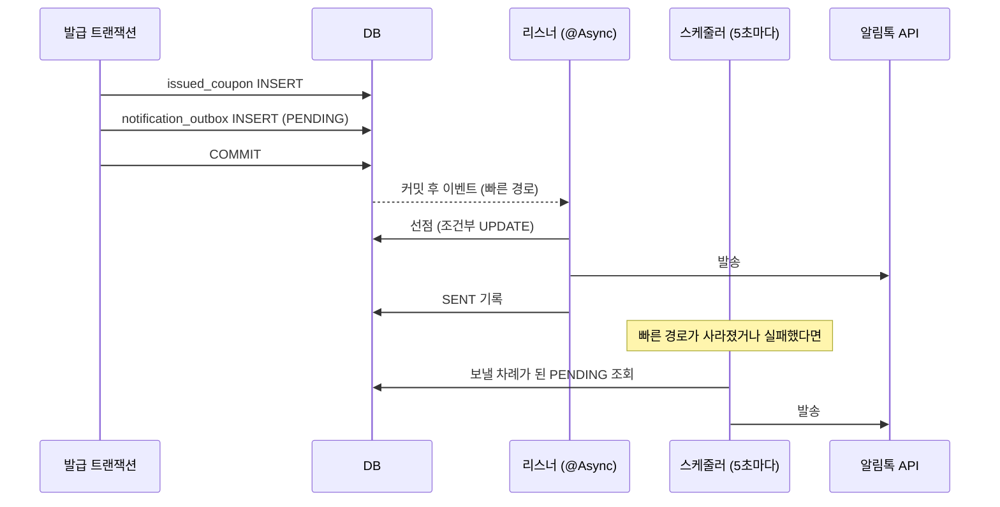
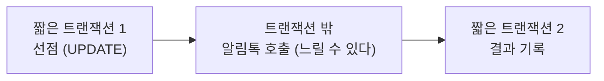
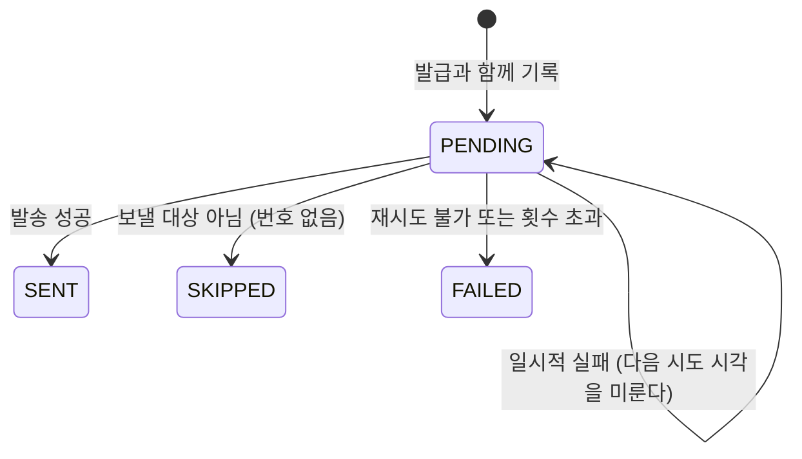

# 8장. 비동기와 신뢰성 — 알림을 "반드시 한 번은" 보내기

**한 줄 요약**: 외부 API 호출(알림톡)을 발급 트랜잭션에 넣으면 느려지고, 트랜잭션 밖에서 그냥 보내면 서버가 죽을 때 사라집니다. "보낼 알림"을 발급과 **같은 트랜잭션**에 기록해 두고(Outbox), 커밋 직후 바로 보내 보되 실패하면 스케줄러가 이어서 보냅니다.

## 1. 문제 — 두 군데에 써야 할 때

쿠폰을 발급하면 알림톡을 보냅니다. 할 일은 두 가지입니다.

1. DB 에 쿠폰 저장
2. 카카오 알림톡 API 호출

둘을 어떻게 묶어도 문제가 생깁니다.

| 방법 | 문제 |
|---|---|
| 트랜잭션 안에서 API 호출 | API 가 2초 걸리면 그동안 DB 커넥션과 행 잠금을 쥔다. 발급이 롤백돼도 알림은 이미 나갔다 |
| 커밋 후 같은 스레드에서 호출 | 사용자가 알림 API 응답까지 기다린다 |
| 커밋 후 별도 스레드(`@Async`)로 호출 | 빠르지만, 보내기 전에 서버가 재시작되면 알림이 **사라진다** |

DB 와 외부 시스템, 두 곳에 함께 쓰는 문제(dual write)는 하나의 트랜잭션으로 묶을 수 없습니다.

## 2. 이 프로젝트가 거쳐 온 길

| 커밋 | 방식 | 남은 문제 |
|---|---|---|
| `f41656c` | 커밋 후(`AFTER_COMMIT`) + `@Async` 로 발송, 실패 시 재시도 | 메모리에만 있는 작업이라 서버가 죽으면 유실 |
| `bf55fde` | **Transactional Outbox** 로 전환 | (아래) |

두 번째 커밋 메시지가 "알림을 Transactional Outbox 로 전환해 서버 재시작 시 유실 방지"입니다.

## 3. Transactional Outbox

핵심은 간단합니다. **외부로 보낼 일을 "DB 의 행"으로 바꾼다.** DB 행은 쿠폰과 같은 트랜잭션에 넣을 수 있습니다.

[V3__create_notification_outbox.sql](../src/main/resources/db/migration/V3__create_notification_outbox.sql#L1-L2)

```sql
-- 보낼 알림을 발급과 같은 트랜잭션에서 기록해 두는 Outbox.
-- 발급이 커밋되면 알림 기록도 반드시 남으므로, 발송 직전에 서버가 죽어도 재기동 후 이어서 보낼 수 있다.
```



### 기록 — 같은 트랜잭션이 아니면 예외

[NotificationOutboxService.kt](../src/main/kotlin/com/site/domain/notification/service/NotificationOutboxService.kt#L23-L40)

```kotlin
    /**
     * 발급 알림을 Outbox 에 기록한다.
     *
     * MANDATORY: 호출하는 쪽에 트랜잭션이 없으면 예외가 난다. Outbox 는 "비즈니스 변경과 같은 트랜잭션"이어야 의미가 있기 때문이다.
     * (따로 커밋되면 발급은 됐는데 알림 기록은 없거나, 그 반대가 생긴다)
     */
    @Transactional(propagation = Propagation.MANDATORY)
    fun recordCouponIssued(event: CouponIssuedEvent) {
        val outbox = outboxRepository.save(
            NotificationOutbox(
                type = NotificationType.COUPON_ISSUED,
                payload = objectMapper.writeValueAsString(event),
                nextAttemptAt = LocalDateTime.now(clock),
            ),
        )
        // 커밋되면 바로 보내 보라는 신호 (빠른 경로). 이 신호가 사라져도 스케줄러가 나중에 보낸다.
        eventPublisher.publishEvent(NotificationOutboxRecorded(outbox.id))
    }
```

`Propagation.MANDATORY` 가 이 설계의 안전장치입니다. 누가 실수로 트랜잭션 밖에서 이 메서드를 부르면, 조용히 따로 커밋되는 대신 **즉시 예외**가 납니다. 규칙을 주석이 아니라 코드로 강제한 것입니다.

발급 쪽에서는 쿠폰 저장 직후 부릅니다.

```kotlin
// CouponIssueService.saveIssuedCoupon
        // 같은 트랜잭션에서 "보낼 알림"을 기록한다. 발급이 롤백되면 알림 기록도 함께 사라진다. (Transactional Outbox)
        notificationOutboxService.recordCouponIssued(
            CouponIssuedEvent(issuedCouponId = issuedCoupon.id, couponEventId = couponEventId, memberId = memberId),
        )
```

payload 에는 메시지 문구가 아니라 **ID 만** 담습니다. ([NotificationOutbox.kt](../src/main/kotlin/com/site/domain/notification/entity/NotificationOutbox.kt) 주석: "알림에 필요한 정보(JSON). 메시지 문구는 보낼 때 최신 데이터로 만든다.")

## 4. 빠른 경로 — 커밋 직후, 다른 스레드에서

[NotificationOutboxEventListener.kt](../src/main/kotlin/com/site/domain/notification/service/NotificationOutboxEventListener.kt#L9-L23)

```kotlin
/**
 * 빠른 경로: 발급이 커밋되면 별도 스레드에서 바로 보내 본다.
 * 이 경로가 실패하거나 사라져도(서버 재시작, 스레드 풀 포화) Outbox 에 기록이 남아 있으므로 스케줄러가 나중에 보낸다.
 */
@Component
class NotificationOutboxEventListener(
    private val processor: NotificationOutboxProcessor,
) {

    @Async(AsyncExecutors.NOTIFICATION)
    @TransactionalEventListener(phase = TransactionPhase.AFTER_COMMIT)
    fun handle(event: NotificationOutboxRecorded) {
        processor.process(event.outboxId)
    }
}
```

| 애너테이션 | 뜻 |
|---|---|
| `@TransactionalEventListener(AFTER_COMMIT)` | 이벤트를 발행한 트랜잭션이 **커밋된 뒤에만** 실행. 롤백되면 실행 안 됨 |
| `@Async("notificationExecutor")` | 요청 스레드가 아니라 알림 전용 스레드 풀에서 실행. 사용자는 기다리지 않는다 |

그냥 `@EventListener` 였다면 커밋 **전에** 실행돼서, 아직 커밋되지 않은(그리고 롤백될 수도 있는) 행을 보내려 했을 겁니다.

### 스레드 풀 — 넘치면 버린다, 그래도 괜찮다

[AsyncConfig.kt](../src/main/kotlin/com/site/infrastructure/async/AsyncConfig.kt#L16-L34)

```kotlin
    /**
     * 알림 발송 전용 스레드 풀. 외부 API 가 느려져도 다른 비동기 작업까지 막히지 않게 용도별로 나눈다.
     * 가상 스레드를 켜도 이 풀은 플랫폼 스레드 최대 8개로 둔다. 동시 발송 수를 묶어 외부 API 와 DB 커넥션을 지키는 것이 이 풀의 역할이다.
     *
     * 큐(1000)까지 가득 차면 빠른 발송만 건너뛴다. 알림은 Outbox 에 남아 있어 스케줄러가 나중에 보낸다.
     * 기본 정책(AbortPolicy)이면 예외가 발급 요청 스레드로 터져서, 쿠폰은 발급됐는데 API 는 500 을 응답하게 된다.
     */
    @Bean(AsyncExecutors.NOTIFICATION)
    fun notificationExecutor(): ThreadPoolTaskExecutor =
        ThreadPoolTaskExecutor().apply {
            corePoolSize = 4
            maxPoolSize = 8
            queueCapacity = 1_000
            setThreadNamePrefix("notification-")
            setRejectedExecutionHandler { _, _ -> log.warn("알림 발송 큐가 가득 차서 빠른 발송을 건너뜁니다. Outbox 스케줄러가 나중에 보냅니다.") }
            // 배포 등으로 종료될 때 이미 받은 알림 작업은 최대 10초까지 마저 처리한다
            setWaitForTasksToCompleteOnShutdown(true)
            setAwaitTerminationSeconds(10)
        }
```

빠른 경로는 **있으면 좋은 것**이지 필수가 아닙니다. 그래서 넘치면 버려도 됩니다. Outbox 가 없었다면 이런 결정을 할 수 없습니다.

## 5. 느린 경로 — 스케줄러가 남은 것을 줍는다

[NotificationOutboxScheduler.kt](../src/main/kotlin/com/site/domain/notification/service/NotificationOutboxScheduler.kt#L7-L18)

```kotlin
/** 느린 경로: 보낼 차례가 된 PENDING 건(빠른 경로 유실분, 재시도 대기분)을 주기적으로 보낸다. */
@Component
@ConditionalOnProperty(prefix = "notification.outbox.scheduler", name = ["enabled"], havingValue = "true", matchIfMissing = true)
class NotificationOutboxScheduler(
    private val processor: NotificationOutboxProcessor,
) {

    @Scheduled(fixedDelayString = "\${notification.outbox.scheduler.interval-millis:5000}")
    fun run() {
        processor.processDue()
    }
}
```

- `fixedDelay`: 이전 실행이 **끝난 뒤** 5초. 처리가 오래 걸려도 실행이 겹치지 않는다.
- 스케줄러 스레드는 `spring.task.scheduling.pool.size=3` 입니다. 기본값 1개면 알림 발송이 느릴 때 대기열 워커(200ms 주기)까지 밀립니다. ([application.properties](../src/main/resources/application.properties) 주석)
- 조회는 `(status, next_attempt_at)` 인덱스를 탑니다. (V3 마이그레이션)

## 6. 두 경로가 같은 건을 동시에 잡으면? — 선점(claim)

빠른 경로와 스케줄러가 같은 건을 동시에 집을 수 있습니다. 둘 다 보내면 알림이 두 번 갑니다. **조건부 UPDATE 로 먼저 잡은 쪽만** 보냅니다.

[NotificationOutboxRepository.kt](../src/main/kotlin/com/site/domain/notification/repository/NotificationOutboxRepository.kt#L22-L42)

```kotlin
    /**
     * 보낼 차례가 된 PENDING 건만 다음 시도 시각을 lease 만큼 미뤄서 선점한다. 바뀐 행이 1 이면 내가 선점한 것이다.
     * 빠른 경로(커밋 직후)와 스케줄러가 같은 건을 동시에 집어도 한쪽만 보낸다.
     * 보내는 도중 서버가 죽으면 lease 가 지난 뒤 스케줄러가 다시 집어 간다.
     */
    @Modifying
    @Query(
        """
        update NotificationOutbox o
           set o.nextAttemptAt = :leaseUntil
         where o.id = :id
           and o.status = :status
           and o.nextAttemptAt <= :now
        """,
    )
    fun claim(
        id: Long,
        status: OutboxStatus,
        now: LocalDateTime,
        leaseUntil: LocalDateTime,
    ): Int
```

[7장](07-concurrency.md)의 원자적 UPDATE 와 같은 기법입니다. "보낼 차례인가 확인"과 "내 것으로 표시"를 한 문장에 넣었습니다.

별도의 "처리 중" 상태를 두지 않고 `nextAttemptAt` 을 30초 뒤로 미루는 것이 영리한 부분입니다. 보내던 서버가 죽으면 30초 뒤 이 건은 다시 "보낼 차례"가 되어 스케줄러가 줍습니다. **lease(임대)** 라고 부르는 방식이고, [9장](09-redis-queue.md)의 대기열에도 똑같이 나옵니다.

## 7. 처리 — 외부 호출은 트랜잭션 밖에서

[NotificationOutboxProcessor.kt](../src/main/kotlin/com/site/domain/notification/service/NotificationOutboxProcessor.kt#L20-L63)

```kotlin
/**
 * Outbox 한 건을 보낸다: 선점 → (트랜잭션 밖에서) 발송 → 결과 기록.
 *
 * 외부 API 호출을 트랜잭션 밖에 두는 이유: 알림톡 응답을 기다리는 동안 DB 커넥션과 행 잠금을 붙잡지 않기 위해서다.
 * 그래서 @Transactional 대신 TransactionTemplate 으로 짧은 트랜잭션을 두 번 연다.
 */
@Component
class NotificationOutboxProcessor(
    private val outboxRepository: NotificationOutboxRepository,
    private val couponNotificationService: CouponNotificationService,
    private val objectMapper: ObjectMapper,
    private val properties: NotificationOutboxProperties,
    private val transactionTemplate: TransactionTemplate,
    private val metrics: NotificationOutboxMetrics,
    private val clock: Clock,
) {

    private val log = LoggerFactory.getLogger(javaClass)

    /** 보낼 차례가 된 건을 모두 처리한다. (스케줄러) */
    fun processDue() {
        outboxRepository.findDueIds(OutboxStatus.PENDING, now(), PageRequest.of(0, properties.batchSize))
            .forEach { outboxId ->
                runCatching { process(outboxId) }
                    .onFailure { log.error("Outbox 처리 중 오류. outboxId={}", outboxId, it) }
            }
    }

    fun process(outboxId: Long) {
        val now = now()
        val claimed = transactionTemplate.execute {
            outboxRepository.claim(outboxId, OutboxStatus.PENDING, now, now.plus(properties.lease))
        } == 1
        if (!claimed) return // 다른 쪽이 이미 보냈거나 보내는 중

        val outbox = outboxRepository.findByIdOrNull(outboxId) ?: return
        val result = runCatching { send(outbox) }
            .getOrElse { NotificationResult.Failed(reason = it.message ?: it.javaClass.simpleName, retryable = true) }

        transactionTemplate.executeWithoutResult {
            val current = outboxRepository.findByIdOrNull(outboxId) ?: return@executeWithoutResult
            current.apply(result, now())
        }
    }
```



- `@Transactional` 은 메서드 전체를 하나로 묶습니다. 중간에 끊고 싶으면 `TransactionTemplate` 으로 원하는 구간만 트랜잭션으로 엽니다.
- `processDue` 는 한 건이 실패해도 나머지를 계속 처리합니다(`runCatching` + 로그).
- `return@executeWithoutResult` 는 람다에서만 빠져나가는 레이블 반환입니다. 그냥 `return` 은 바깥 함수 `process` 를 끝냅니다.

### 결과에 따라 다음 상태

[NotificationResult.kt](../src/main/kotlin/com/site/domain/notification/NotificationResult.kt)

```kotlin
/** 알림 한 건을 처리한 결과. Outbox 는 이 결과로 다음 상태를 정한다. */
sealed interface NotificationResult {
    data object Sent : NotificationResult

    /** 보낼 대상이 아니다 (휴대폰 번호 없음, 회원 탈퇴 등) — 다시 시도하지 않는다 */
    data class Skipped(
        val reason: String,
    ) : NotificationResult

    data class Failed(
        val reason: String,
        val retryable: Boolean,
    ) : NotificationResult
}
```

[NotificationOutbox.kt](../src/main/kotlin/com/site/domain/notification/entity/NotificationOutbox.kt#L74-L91)

```kotlin
    /**
     * 실패를 기록한다. 다시 보낼 만한 실패이고 횟수가 남았으면 backoff × 시도 횟수 뒤로 미루고, 아니면 FAILED 로 끝낸다.
     */
    fun recordFailure(
        now: LocalDateTime,
        reason: String,
        retryable: Boolean,
        maxAttempts: Int,
        backoff: Duration,
    ) {
        attemptCount++
        if (retryable && attemptCount < maxAttempts) {
            lastError = reason.take(MAX_ERROR_LENGTH)
            nextAttemptAt = now.plus(backoff.multipliedBy(attemptCount.toLong()))
        } else {
            finish(OutboxStatus.FAILED, now, error = reason)
        }
    }
```



| 결과 | 다음 | 예 |
|---|---|---|
| `Sent` | SENT | 정상 |
| `Skipped` | SKIPPED, 재시도 안 함 | 휴대폰 번호 없음 |
| `Failed(retryable = true)` | 10초 × 시도 횟수 뒤 다시 (최대 5회) | 네트워크 오류 |
| `Failed(retryable = false)` | FAILED | 잘못된 API 키, 미등록 발신번호 |

재시도는 **스레드를 재우지 않고** 다음 시도 시각을 미뤄 둡니다. ([NotificationOutbox.kt](../src/main/kotlin/com/site/domain/notification/entity/NotificationOutbox.kt) 주석: "재시도는 스레드를 재우는 대신 다음 시도 시각(nextAttemptAt)을 미뤄 두고, 스케줄러가 그때 다시 집어 간다.") `Thread.sleep` 으로 기다리면 그동안 스레드 풀이 막히고, 서버가 재시작되면 재시도도 사라집니다.

어떤 실패가 다시 보낼 만한지는 외부 API 를 아는 어댑터([SolapiAlimtalkSender](../src/main/kotlin/com/site/infrastructure/biztalk/SolapiAlimtalkSender.kt))가 판단해서 `retryable` 로 알려 줍니다. 판단 기준은 기술 쪽에, 재시도 정책은 domain 쪽에 있습니다.

## 8. 보장하는 것과 보장하지 않는 것

| 상황 | 결과 |
|---|---|
| 발급 롤백 | Outbox 행도 롤백 → 알림 안 나감 |
| 커밋 직후 서버 다운 (빠른 경로 실행 전) | 재기동 후 스케줄러가 보냄 |
| 스레드 풀 포화 | 빠른 경로만 건너뜀 → 스케줄러가 보냄 |
| 발송은 성공했는데 결과 기록 전에 서버 다운 | lease 가 지난 뒤 **한 번 더 보낼 수 있다** |

마지막 줄이 중요합니다. 이 설계는 "최소 한 번(at-least-once)" 전달입니다. 정확히 한 번은 외부 API 가 같은 요청을 알아보는 기능(멱등 키)을 제공해야 가능합니다. 쿠폰 알림이 드물게 두 번 가는 것은 받아들일 수 있다고 봤습니다.

테스트로 확인하는 것들:

[NotificationOutboxTest.kt](../src/test/kotlin/com/site/domain/notification/NotificationOutboxTest.kt#L86-L112)

```kotlin
    @Test
    fun `발급 트랜잭션이 롤백되면 Outbox 기록도 남지 않고 알림도 나가지 않는다`() {
        val memberId = saveMember(phoneNumber = "01012345678").id
        val couponEventId = couponEventRepository.save(couponEventFixture()).id

        // 바깥 트랜잭션에 합류해서 발급(+ Outbox 기록)까지 한 뒤, 바깥 트랜잭션을 롤백시킨다
        transactionTemplate.executeWithoutResult { status ->
            couponIssueService.issueWithAtomicUpdate(couponEventId, memberId, CouponIssueMode.DIRECT)
            status.setRollbackOnly()
        }

        assertEquals(0L, outboxRepository.count())
        await.during(Duration.ofSeconds(1)).atMost(Duration.ofSeconds(2)).untilAsserted {
            assertEquals(0, fakeAlimtalkSender.attempts.get())
        }
    }

    @Test
    fun `커밋 직후 서버가 죽어 빠른 발송이 사라져도 스케줄러가 남은 알림을 보낸다`() {
        // 발급은 커밋됐지만 빠른 경로가 실행되기 전에 서버가 죽은 상황: PENDING 기록만 남아 있다
        val outboxId = savePendingOutbox(memberId = saveMember(phoneNumber = "01012345678").id).id

        outboxProcessor.processDue()

        assertEquals(OutboxStatus.SENT, outboxRepository.findById(outboxId).get().status)
        assertEquals(1, fakeAlimtalkSender.sentMessages.size)
    }
```

"서버가 죽은 상황"을 실제로 서버를 죽이지 않고, **그 상황이 DB 에 남기는 흔적(PENDING 행만 있음)을 직접 만들어서** 재현합니다. 장애 테스트를 쉽게 만드는 요령입니다.

## 흔한 실수

| 실수 | 결과 | 대신 |
|---|---|---|
| 트랜잭션 안에서 외부 API 를 부른다 | API 가 느리면 커넥션·잠금을 쥔 채 기다린다 | 커밋 후 / 트랜잭션 밖 |
| `@EventListener` 로 커밋 후 처리를 한다 | 커밋 전에 실행돼, 롤백될 데이터를 처리한다 | `@TransactionalEventListener(AFTER_COMMIT)` |
| `@Async` 작업만으로 "나중에 보낸다" | 서버 재시작 시 유실 | Outbox + 스케줄러 |
| 재시도를 `Thread.sleep` 으로 | 스레드가 묶이고 재시작 시 사라진다 | 다음 시도 시각을 저장 |
| 스레드 풀 거절 정책을 기본(AbortPolicy)으로 | 발급 API 가 500 을 응답 | 거절 시 로그만 (Outbox 가 있으니) |
| 여러 처리자가 같은 건을 동시에 집는다 | 중복 발송 | 조건부 UPDATE 선점 + lease |

## 직접 해보기

1. `NotificationOutboxService.recordCouponIssued` 의 전파를 `REQUIRES_NEW` 로 바꾸면 "롤백되면 Outbox 기록도 남지 않는다" 테스트는 어떻게 되나요? 왜 그런가요?
2. `FakeAlimtalkSender.delay` 를 3초로 두고 쿠폰을 발급하면, 발급 API 응답 시간은 얼마일까요? 예상한 뒤 [NotificationOutboxTest](../src/test/kotlin/com/site/domain/notification/NotificationOutboxTest.kt) 에서 비슷한 테스트를 찾아 확인해 보세요.
3. lease(30초)보다 알림톡 API 가 오래 걸리면 무슨 일이 일어나나요? 어떻게 막을 수 있을까요?

다음 장: [9장. Redis 대기열](09-redis-queue.md)
