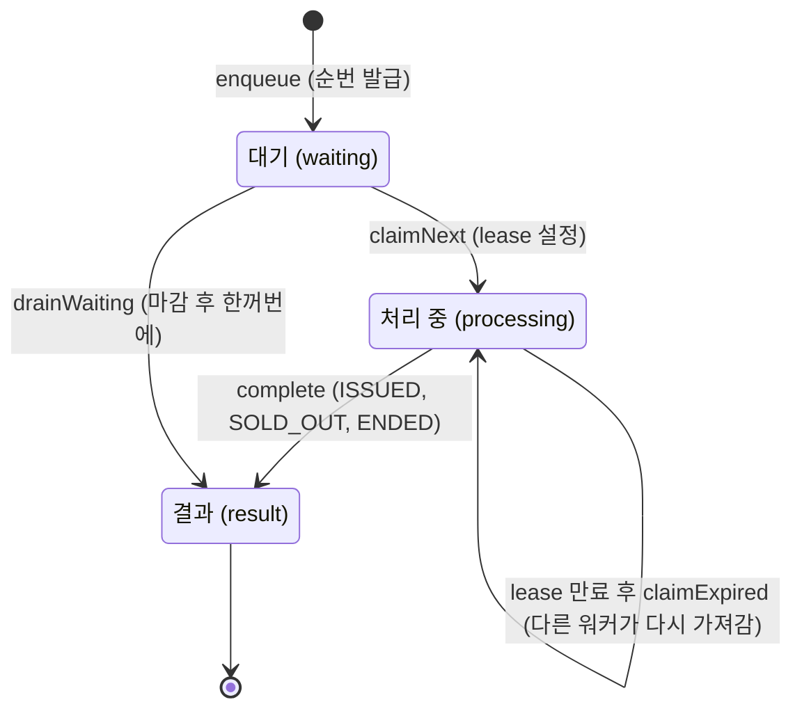

# 9장. Redis 대기열 — DB 를 지키면서 줄 선 순서대로

**한 줄 요약**: 요청 스레드는 Redis 에 줄만 세우고 바로 202 를 돌려줍니다. 워커가 앞에서부터 50명씩 꺼내 DB 에 발급합니다. 상태를 옮기는 모든 연산은 Lua 스크립트 하나로 실행해 "꺼냈는데 어디에도 없는" 중간 상태를 없앱니다.

## 1. 왜 대기열인가

즉시 발급은 몰린 인원만큼 DB 에 요청이 들어갑니다. 5,000명이 몰리면 DB 커넥션 10개를 두고 5,000개 요청이 다툽니다. ([7장](07-concurrency.md))

대기열은 이것을 바꿉니다.

| | 즉시 발급 | 대기열 |
|---|---|---|
| 요청 스레드가 하는 일 | DB 발급까지 | Redis 에 줄 서기만 |
| DB 에 들어가는 속도 | 몰린 만큼 | 워커 속도로 고정 |
| 순서 | 락을 먼저 잡은 사람 | 줄 선 순서 |
| 사용자 경험 | 바로 결과 | "N번째입니다" → 나중에 결과 |

[CouponQueueService.kt](../src/main/kotlin/com/site/domain/coupon/queue/CouponQueueService.kt#L11-L15)

```kotlin
/**
 * 선착순 대기열. 요청 스레드는 Redis 에 줄만 세우고 바로 응답한다. 실제 발급(DB)은 CouponQueueWorker 가 순서대로 처리한다.
 *
 * 대기열은 트래픽을 완충할 뿐이고, "100장 초과 발급 금지" 같은 정합성은 여전히 DB(원자적 UPDATE)가 책임진다.
 */
```

대기열 이벤트는 즉시 발급 API 로 받을 수 없습니다. 섞어 열면 줄 선 사람보다 즉시 발급 API 를 직접 부른 사람이 먼저 받습니다(새치기). 그래서 이벤트마다 발급 방식(`CouponIssueMode`)을 정하고 양쪽 입구에서 확인합니다.

## 2. Redis 자료구조와 키

[RedisCouponQueueStore.kt](../src/main/kotlin/com/site/infrastructure/redis/queue/RedisCouponQueueStore.kt#L11-L25)

```kotlin
/**
 * 쿠폰 대기열의 Redis 저장소.
 *
 * 이벤트별 키 (중괄호는 Redis Cluster 해시 태그 — 같은 이벤트의 키들이 같은 슬롯에 모여서 Lua 스크립트에서 함께 쓸 수 있다)
 * - coupon-queue:{id}:waiting     ZSET   대기 중. score = 들어온 순번
 * - coupon-queue:{id}:processing  ZSET   처리 중. score = lease 만료 시각(epoch ms)
 * - coupon-queue:{id}:seq         STRING 순번 발급용 카운터
 * - coupon-queue:{id}:result      HASH   memberId → 처리 결과
 * - coupon-queue:{id}:closed      STRING 마감 사유. 있으면 더 이상 줄을 설 수 없다
 * 전역 키
 * - coupon-queue:active           SET    대기열이 있는 이벤트 ID (워커가 순회할 대상)
 *
 * 상태를 옮기는 연산은 모두 Lua 스크립트 하나로 실행한다. Redis 는 스크립트 실행 중에 다른 명령을 끼워 넣지 않으므로
 * "꺼냈는데 어디에도 기록되지 않은" 중간 상태가 생기지 않는다.
 */
```

| 자료구조 | 성질 | 여기서 쓰는 이유 |
|---|---|---|
| ZSET (정렬 집합) | 멤버마다 점수, 점수 순 정렬, 중복 없음 | 순번 = 점수. `ZRANK` 로 내 순위, `ZPOPMIN` 으로 앞사람부터 꺼내기 |
| HASH | 키 하나 안의 필드 → 값 | 회원 ID → 결과 |
| STRING + `INCR` | 원자적 증가 | 순번 발급 |
| SET | 중복 없는 집합 | 워커가 돌아야 할 이벤트 목록 |

처리 중 ZSET 의 점수가 "lease 만료 시각"이라는 점을 기억하세요. 점수로 "만료된 것만" 꺼낼 수 있습니다.

## 3. 상태 전이



포트의 주석이 이 전이를 계약으로 적습니다.

[CouponQueueStore.kt](../src/main/kotlin/com/site/domain/coupon/queue/port/CouponQueueStore.kt#L5-L13)

```kotlin
/**
 * 선착순 대기열 저장소 포트. 어떤 연산이 "원자적"이어야 하는지가 이 인터페이스의 계약이다.
 *
 * 회원은 대기(waiting) → 처리 중(processing) → 결과(result) 순서로 옮겨 간다.
 * 처리 중에는 lease(만료 시각)가 붙어서, 처리하던 워커가 죽으면 lease 가 지난 뒤 다른 워커가 다시 가져간다.
 */
interface CouponQueueStore {
    /** 결과 확인 → 처리 중 확인 → 마감 확인 → 대기 중 확인 → 순번 발급 → 추가를 원자적으로 한다. */
    fun enqueue(couponEventId: Long, memberId: Long): EnqueueResult
```

## 4. Lua 스크립트 — 여러 명령을 하나처럼

줄 서기는 확인할 것이 많습니다. 이미 결과가 있나? 처리 중인가? 마감됐나? 이미 줄에 있나? 이것들을 명령 여러 개로 보내면, 사이사이에 워커가 끼어들어 상태가 바뀝니다.

[RedisCouponQueueStore.kt](../src/main/kotlin/com/site/infrastructure/redis/queue/RedisCouponQueueStore.kt#L158-L182)

```kotlin
        // KEYS: waiting, seq, result, closed, processing / ARGV: memberId, ttlSeconds
        private val ENQUEUE_SCRIPT = DefaultRedisScript(
            """
            if redis.call('HEXISTS', KEYS[3], ARGV[1]) == 1 then
              return -2
            end
            if redis.call('ZSCORE', KEYS[5], ARGV[1]) then
              return -2
            end
            if redis.call('EXISTS', KEYS[4]) == 1 then
              return -1
            end
            local rank = redis.call('ZRANK', KEYS[1], ARGV[1])
            if rank then
              return rank
            end
            local seq = redis.call('INCR', KEYS[2])
            redis.call('ZADD', KEYS[1], seq, ARGV[1])
            redis.call('EXPIRE', KEYS[1], ARGV[2])
            redis.call('EXPIRE', KEYS[2], ARGV[2])
            return redis.call('ZRANK', KEYS[1], ARGV[1])
            """.trimIndent(),
            // Long::class.java 는 원시 타입 long 을 가리킨다. 래퍼 클래스(java.lang.Long)가 필요해서 javaObjectType 을 쓴다.
            Long::class.javaObjectType,
        )
```

읽는 법:

- `KEYS[n]` 은 스크립트에 넘긴 키 목록, `ARGV[n]` 은 값 목록입니다. Lua 배열은 1부터 셉니다.
- 위에서부터 차례로 확인하고, 해당하면 바로 돌려줍니다.
- 이미 줄에 있으면 **같은 순번**을 돌려줍니다. 새로고침해도 뒤로 밀리지 않습니다.
- 모든 키에 `EXPIRE` 를 겁니다. 이벤트가 끝난 뒤 키가 Redis 에 영원히 남지 않게 합니다(기본 1일).

`-2`, `-1` 같은 특수 값은 Kotlin 쪽에서 바로 sealed 타입(`EnqueueResult`)으로 바꿉니다. Lua 의 한계(값 하나만 돌려줌)를 경계에서 한 번만 처리하고, 나머지 코드는 의미 있는 타입만 봅니다. ([1장](01-kotlin-basics.md))

### 꺼내기 — 대기에서 처리 중으로

[RedisCouponQueueStore.kt](../src/main/kotlin/com/site/infrastructure/redis/queue/RedisCouponQueueStore.kt#L184-L200)

```kotlin
        // KEYS: waiting, processing / ARGV: count, leaseUntil, ttlSeconds
        // ZPOPMIN 은 [회원, 점수, 회원, 점수, ...] 를 순번 순서로 돌려준다
        private val CLAIM_NEXT_SCRIPT = DefaultRedisScript(
            """
            local popped = redis.call('ZPOPMIN', KEYS[1], ARGV[1])
            local members = {}
            for i = 1, #popped, 2 do
              members[#members + 1] = popped[i]
              redis.call('ZADD', KEYS[2], ARGV[2], popped[i])
            end
            if #members > 0 then
              redis.call('EXPIRE', KEYS[2], ARGV[3])
            end
            return members
            """.trimIndent(),
            List::class.java,
        )
```

`ZPOPMIN` 으로 꺼내고 곧바로 처리 중 ZSET 에 넣습니다. 둘 사이에 워커가 죽어도 회원이 사라지지 않습니다. 스크립트 전체가 실행되거나, 아예 실행되지 않거나 둘 중 하나이기 때문입니다.

### 해시 태그 `{id}`

Redis Cluster 는 키를 16,384 개의 슬롯에 나눠 여러 서버에 둡니다. **Lua 스크립트는 한 슬롯의 키만 다룰 수 있습니다.** 키에 `{7}` 처럼 중괄호가 있으면 클러스터는 중괄호 안만 보고 슬롯을 정합니다. 그래서 `coupon-queue:{7}:waiting` 과 `coupon-queue:{7}:processing` 은 항상 같은 슬롯에 있습니다.

지금은 단일 Redis 를 쓰지만, 키 이름을 처음부터 이렇게 지어 두면 클러스터로 옮길 때 코드를 고치지 않아도 됩니다.

## 5. 워커 — 앞에서부터 50명씩

[CouponQueueWorker.kt](../src/main/kotlin/com/site/domain/coupon/queue/CouponQueueWorker.kt#L14-L70)

```kotlin
/**
 * 대기열에서 앞사람부터 꺼내 실제로 발급한다. CouponQueueScheduler 가 주기적으로 부른다. (테스트에서는 직접 부른다)
 *
 * 한 주기에 하는 일
 * 1. lease 가 지난 "처리 중" 회원을 다시 처리한다 — 이전 워커가 꺼내 놓고 죽은 경우
 * 2. 대기열이 닫혔으면 대기 중인 회원을 DB 를 거치지 않고 같은 결과로 정리한다
 * 3. 앞에서부터 batchSize 명씩 꺼내 한 트랜잭션으로 일괄 발급한다. 줄이 남아 있으면 maxBusyTime 까지 쉬지 않고 이어서 처리한다
 *
 * 같은 회원을 두 번 처리해도 안전하다. 일괄 발급은 이미 받은 회원을 발급된 것으로 돌려준다. (멱등)
 */
@Component
class CouponQueueWorker(
    private val couponQueueStore: CouponQueueStore,
    private val couponIssueService: CouponIssueService,
    private val properties: CouponQueueProperties,
    private val issueMetrics: CouponIssueMetrics,
    private val queueMetrics: CouponQueueMetrics,
    private val clock: Clock,
) {

    private val log = LoggerFactory.getLogger(javaClass)

    fun processAll() {
        couponQueueStore.activeEventIds().forEach { couponEventId ->
            runCatching { process(couponEventId) }
                .onFailure { log.error("대기열 처리 중 오류. couponEventId={}", couponEventId, it) }
        }
        queueMetrics.refresh(couponQueueStore.activeEventIds())
    }

    private fun process(couponEventId: Long) {
        val startedAt = clock.millis()

        val expired = couponQueueStore.claimExpired(couponEventId, startedAt, properties.batchSize, leaseUntil())
        if (expired.isNotEmpty()) {
            log.warn("처리 중에 멈춘 회원 {}명을 다시 처리합니다. couponEventId={}", expired.size, couponEventId)
            // 발급까지 끝낸 뒤 죽었을 수도 있지만, 일괄 발급은 이미 받은 회원을 발급된 것으로 돌려주므로 마감 여부와 상관없이 다시 처리한다
            issueBatch(couponEventId, expired)
        }

        while (true) {
            couponQueueStore.closedReason(couponEventId)?.let { reason ->
                drain(couponEventId, reason)
                return
            }

            val claimed = couponQueueStore.claimNext(couponEventId, properties.batchSize, leaseUntil())
            if (claimed.isEmpty()) {
                couponQueueStore.deactivateIfEmpty(couponEventId)
                return
            }
            issueBatch(couponEventId, claimed)

            // 꽉 찬 배치였다면 줄이 더 남아 있을 수 있으니 쉬지 않고 이어서 처리한다 (한 이벤트에 maxBusyTime 까지만)
            if (claimed.size < properties.batchSize || clock.millis() - startedAt >= properties.maxBusyTime.toMillis()) return
        }
    }
```

워커는 스케줄러가 200ms 마다 부릅니다(`fixedDelay`, [CouponQueueScheduler.kt](../src/main/kotlin/com/site/domain/coupon/queue/CouponQueueScheduler.kt)). 이벤트 하나에서 오류가 나도 `runCatching` 으로 다른 이벤트는 계속 처리합니다.

### 일괄 발급 — 50명에 커밋 한 번

M3 의 워커는 회원마다 트랜잭션을 열었습니다. 커밋(디스크 기록)이 회원 수만큼 일어나서, 1,000장을 나눠 주는 데 12초가 걸렸습니다. M4 에서 50명을 한 트랜잭션으로 묶었습니다.

[CouponIssueService.kt](../src/main/kotlin/com/site/domain/coupon/service/CouponIssueService.kt#L87-L125)

```kotlin
    /**
     * 대기열 워커 전용: 꺼낸 회원들을 한 트랜잭션에서 한꺼번에 발급한다.
     *
     * 이벤트 행을 잠그고(SELECT ... FOR UPDATE) 남은 수량만큼 앞사람부터 나눠 준다. 회원마다 트랜잭션을 열면
     * 커밋(디스크 기록)이 회원 수만큼 일어나지만, 여기서는 배치당 한 번이다.
     * 이미 받은 회원(이전 처리 도중 워커가 죽은 경우)은 다시 발급하지 않고 발급된 것으로 돌려준다. (다시 처리해도 안전하다)
     * 행 잠금 덕분에 워커가 여러 대여도 수량을 넘지 않는다.
     */
    @Transactional
    fun issueQueuedBatch(couponEventId: Long, memberIds: List<Long>): QueuedBatchIssueResult {
        val now = now()
        val couponEvent = couponEventRepository.findByIdForUpdate(couponEventId)
            ?: throw ServiceException(ErrorCode.COUPON_EVENT_NOT_FOUND)
        couponEvent.checkIssueMode(CouponIssueMode.QUEUE)

        val alreadyIssued = issuedCouponRepository.findIssuedMemberIds(couponEventId, memberIds).toSet()
        val candidates = memberIds.filterNot { it in alreadyIssued }
        val status = couponEvent.status(now)
        val winners = if (status == CouponEventStatus.ONGOING) candidates.take(couponEvent.remainingQuantity) else emptyList()

        if (winners.isNotEmpty()) {
            couponEvent.issue(now, quantity = winners.size)
            val expiresAt = couponEvent.couponExpiresAt(now)
            issuedCouponRepository.saveAll(winners.map { IssuedCoupon(couponEventId = couponEventId, memberId = it, expiresAt = expiresAt) })
                .forEach { notificationOutboxService.recordCouponIssued(CouponIssuedEvent(it.id, couponEventId, it.memberId)) }
        }

        val issued = alreadyIssued + winners
        return QueuedBatchIssueResult(
            issued = memberIds.filter { it in issued },
            rejected = candidates.drop(winners.size),
            rejectReason = when (status) {
                CouponEventStatus.ENDED -> ErrorCode.COUPON_EVENT_ENDED
                CouponEventStatus.UPCOMING -> ErrorCode.COUPON_EVENT_NOT_STARTED
                else -> ErrorCode.COUPON_SOLD_OUT
            },
            remainingQuantity = couponEvent.remainingQuantity,
        )
    }
```

여기서는 원자적 UPDATE 대신 **비관적 락**을 씁니다. "남은 수량을 보고 그만큼 앞사람에게 나눠 준다"는 판단을 UPDATE 한 문장으로 쓰기 어렵기 때문입니다. 행을 잠그는 것은 워커 하나가 배치당 한 번이라, 즉시 발급처럼 수천 명이 커넥션을 쥔 채 기다리는 일은 없습니다.

### 멱등 — 두 번 처리해도 같은 결과

워커가 50명을 DB 에 발급하고 커밋한 직후, Redis 에 결과를 기록하기 전에 죽었다고 해 봅시다. lease 가 지나면 다른 워커가 그 50명을 다시 가져갑니다. 이미 받은 회원을 또 발급하면 안 됩니다.

`findIssuedMemberIds` 로 이미 받은 회원을 찾아 **발급된 것으로** 돌려줍니다. 같은 입력을 두 번 처리해도 결과가 같은 성질을 **멱등성**이라고 합니다. lease 로 재처리하는 구조라면 처리 로직이 반드시 멱등이어야 합니다.

### 결과 기록과 마감

[CouponQueueWorker.kt](../src/main/kotlin/com/site/domain/coupon/queue/CouponQueueWorker.kt#L72-L89)

```kotlin
    private fun issueBatch(couponEventId: Long, memberIds: List<Long>) {
        val batch = try {
            couponIssueService.issueQueuedBatch(couponEventId, memberIds)
        } catch (e: Exception) {
            log.warn("일괄 발급에 실패해 한 명씩 다시 처리합니다. couponEventId={}, members={}", couponEventId, memberIds.size, e)
            null
        }
        val results = batch?.toQueueResults() ?: memberIds.associateWith { issueOne(couponEventId, it) }

        results.entries.groupBy({ it.value }, { it.key }).forEach { (result, ids) ->
            couponQueueStore.complete(couponEventId, ids, result)
            issueMetrics.recordQueue(result, count = ids.size.toLong())
        }
        // 소진·종료를 만나면 대기열을 닫아 새로 줄 서는 것을 막는다. 남은 대기자는 다음 반복에서 한꺼번에 정리한다
        results.values.firstOrNull { it.closesQueue }?.let { couponQueueStore.close(couponEventId, it) }
        // 조회 간격 힌트가 "남은 수량만큼 처리되면 결과가 나온다"를 계산할 수 있게 남겨 둔다
        batch?.let { couponQueueStore.saveRemainingQuantity(couponEventId, it.remainingQuantity) }
    }
```

- 일괄 발급이 통째로 실패하면(예: 한 명의 데이터 문제) 한 명씩 원자적 UPDATE 로 다시 시도합니다. 한 사람 때문에 50명이 모두 실패하지 않게 합니다.
- 소진을 만나면 대기열을 **닫습니다**. 뒤에 선 사람은 DB 에 갈 필요 없이 모두 소진이므로, 다음 반복에서 `drainWaiting` 이 1,000명씩 한꺼번에 결과를 씁니다.
- 일괄 발급이 성공하면 **남은 수량을 Redis 에 남깁니다**(M5). 아래 6절의 조회 간격 힌트가 "언제 결과가 나올지"를 추정할 때 씁니다.

[CouponQueueResult.kt](../src/main/kotlin/com/site/domain/coupon/queue/CouponQueueResult.kt)

```kotlin
/**
 * 대기열에서 꺼내져 처리된 결과.
 * @property closesQueue 이 결과가 나오면 뒤에 선 사람도 모두 같은 결과가 되므로 대기열을 닫는다.
 */
enum class CouponQueueResult(
    val closesQueue: Boolean,
) {
    ISSUED(closesQueue = false),
    SOLD_OUT(closesQueue = true),
    ENDED(closesQueue = true),
    FAILED(closesQueue = false),
}
```

## 6. 사용자는 결과를 어떻게 아나

### 조회(polling)와 간격 힌트

클라이언트는 `GET /queue/me` 로 내 상태를 묻습니다. M3 에서는 모두가 0.5초마다 물었습니다. 2,000명이 12초 기다리면 HTTP 요청이 38,000건이 넘었고, 대부분 "아직 대기 중"이라는 같은 답이었습니다.

M4 에서는 서버가 **다음에 언제 물어보라**고 알려 줍니다.

[CouponQueuePollingPolicy.kt](../src/main/kotlin/com/site/domain/coupon/queue/CouponQueuePollingPolicy.kt#L8-L47)

```kotlin
/**
 * 대기열 상태를 언제 다시 물어보면 되는지 알려준다. (응답의 retryAfterMillis)
 *
 * 모두가 0.5초마다 물으면, 1,950번째 사용자의 조회는 대부분 "아직 대기 중"이라는 같은 답을 받는다.
 * 남은 예상 대기 시간의 절반 뒤에 다시 묻게 하면, 결과를 늦게 알게 되는 일 없이 조회 수가 순번에 맞게 준다.
 *
 * 예상 대기 시간은 "내 결과가 나오기 전까지 처리될 인원 ÷ 처리량"이다.
 * 남은 수량보다 뒤에 선 사람은 내 앞사람이 다 처리될 때가 아니라 소진되는 순간 결과(소진)를 받으므로, 처리될 인원은 min(순번, 남은 수량)이다.
 * 순번만 보면 쿠폰 100장에 2,000번째 사용자에게 2초 뒤에 물으라고 하는데, 실제 결과는 100명이 처리되자마자 나온다.
 */
@Component
class CouponQueuePollingPolicy(
    private val properties: CouponQueuePollingProperties,
    private val queueProperties: CouponQueueProperties,
    private val couponQueueStore: CouponQueueStore,
) {

    /** 다시 물어볼 때까지 기다릴 시간(ms). 결과가 나왔거나 대기열에 없으면 null — 더 물을 필요가 없다 */
    fun retryAfterMillis(couponEventId: Long, status: CouponQueueStatus): Long? {
        // 남은 수량은 기다리는 사람에게만 필요하다 (Redis 조회를 아낀다)
        val remainingQuantity = if (status is CouponQueueStatus.Waiting) couponQueueStore.remainingQuantity(couponEventId) else null
        return retryAfterMillis(status, remainingQuantity)
    }

    /** @param remainingQuantity 워커가 마지막으로 확인한 남은 수량. 모르면 null (순번만으로 추정) */
    fun retryAfterMillis(status: CouponQueueStatus, remainingQuantity: Int?): Long? =
        when (status) {
            CouponQueueStatus.Processing -> properties.minInterval.toMillis()
            is CouponQueueStatus.Waiting -> {
                val processedBeforeMyResult = remainingQuantity?.let { minOf(status.position, it.toLong()) } ?: status.position
                if (processedBeforeMyResult <= queueProperties.batchSize) {
                    properties.minInterval.toMillis() // 다음 배치 안에 결과가 나온다
                } else {
                    val expectedWaitMillis = processedBeforeMyResult * 1_000 / properties.estimatedThroughputPerSecond
                    (expectedWaitMillis / 2).coerceIn(properties.minInterval.toMillis(), properties.maxInterval.toMillis())
                }
            }
            is CouponQueueStatus.Done, CouponQueueStatus.NotInQueue -> null
        }
}
```

순번 1,000번이면: 예상 대기 = 1,000 ÷ 초당 500명 = 2초 → 그 절반인 1초 뒤에 다시 묻게 합니다. 0.3초~3초 사이로 제한합니다(`coerceIn`).

**남은 수량을 보는 이유 (M5)**: 처음(M4)에는 순번만 봤습니다. 100장짜리에 2,000명이 줄 서면 2,000번째 사용자는 "2초 뒤에 물어보라"는 힌트를 받았는데, 실제로는 100장이 금방 소진되고 나머지는 곧바로 "소진"으로 정리됩니다. 결과는 이미 나왔는데 다음 조회 때까지 모르는 것입니다. 그래서 100장 · 2,000명에서는 결과까지 p95 가 M3 보다 늘었습니다(1.87s → 2.38s).

남은 수량보다 뒤에 선 사람은 "앞사람이 다 처리될 때"가 아니라 **"소진되는 순간"** 결과를 받습니다. 그때까지 처리되는 인원은 남은 수량만큼이므로, 예상 대기를 `min(순번, 남은 수량) ÷ 처리량` 으로 계산합니다.

| 순번 · 남은 수량 | 순번만 볼 때 | 남은 수량도 볼 때 |
|---|---|---|
| 2,000번 · 50장 | 2초 | 0.3초 (다음 배치에 소진) |
| 2,000번 · 1,000장 | 2초 | 1초 |
| 1,000번 · 5,000장 | 1초 | 1초 (순번이 더 앞) |

남은 수량은 워커가 일괄 발급할 때마다 Redis 에 남깁니다(위 `issueBatch` 의 `saveRemainingQuantity`). DB 를 읽지 않고, 기다리는 사람에게만 읽습니다.

### SSE — 서버가 밀어 주기

조회 대신 연결 하나를 열어 두면, 상태가 바뀔 때마다 서버가 보내 줍니다(Server-Sent Events).

[CouponQueueStatusStreams.kt](../src/main/kotlin/com/site/presentation/coupon/stream/CouponQueueStatusStreams.kt#L12-L79)

```kotlin
/**
 * 대기열 상태를 SSE(Server-Sent Events)로 밀어 준다. 연결 하나로 결과가 나올 때까지 기다린다.
 *
 * 클라이언트가 0.5초마다 묻는 대신, 이 서버가 0.5초마다 Redis 에서 상태를 확인하고 "바뀌었을 때만" 보낸다.
 * HTTP 요청·응답 왕복과 인증 처리가 연결 하나로 줄어든다. 결과(DONE)를 보내면 연결을 닫는다.
 *
 * 연결 목록은 서버(인스턴스)마다 따로 갖는다. 상태의 원본은 Redis 라서 서버가 여러 대여도 각자 자기 연결만 챙기면 된다.
 * 연결은 스레드를 붙잡지 않는다 (Servlet 비동기 처리).
 */
@Component
class CouponQueueStatusStreams(
    private val couponQueueService: CouponQueueService,
) {

    private val log = LoggerFactory.getLogger(javaClass)
    private val subscriptions = ConcurrentHashMap<SseEmitter, Subscription>()

    private class Subscription(
        val couponEventId: Long,
        val memberId: Long,
    ) {
        @Volatile
        var lastSent: CouponQueueStatus? = null
    }

    fun subscribe(couponEventId: Long, memberId: Long): SseEmitter {
        val emitter = SseEmitter(TIMEOUT.toMillis())
        val subscription = Subscription(couponEventId, memberId)
        subscriptions[emitter] = subscription

        emitter.onCompletion { subscriptions.remove(emitter) }
        emitter.onTimeout {
            // 클라이언트가 다시 연결한다
            subscriptions.remove(emitter)
            emitter.complete()
        }
        emitter.onError { subscriptions.remove(emitter) }

        push(emitter, subscription) // 연결하자마자 현재 상태를 보낸다
        return emitter
    }

    /** 연결된 모든 사용자의 상태를 확인해, 바뀐 사람에게만 보낸다. (스케줄러) */
    fun pushAll() {
        subscriptions.forEach { (emitter, subscription) -> push(emitter, subscription) }
    }

    fun connectionCount(): Int = subscriptions.size

    private fun push(emitter: SseEmitter, subscription: Subscription) {
        val status = couponQueueService.getStatus(subscription.couponEventId, subscription.memberId)
        if (status == subscription.lastSent) return
        subscription.lastSent = status

        try {
            emitter.send(SseEmitter.event().name(EVENT_NAME).data(status.toResponse()))
            // 결과가 나왔거나 대기열에 없으면 더 보낼 것이 없다.
            // 목록에서 직접 뺀다. 연결하자마자 닫는 경우 onCompletion 콜백이 언제 불리는지는 서블릿 컨테이너마다 다르다.
            if (status is CouponQueueStatus.Done || status == CouponQueueStatus.NotInQueue) {
                subscriptions.remove(emitter)
                emitter.complete()
            }
        } catch (e: Exception) {
            // 클라이언트가 이미 끊은 경우
            log.debug("대기열 상태 전송 실패, 연결을 정리합니다. {}", e.message)
            subscriptions.remove(emitter)
        }
    }
```

- `SseEmitter` 를 돌려주면 요청 스레드는 바로 반환되고, 응답 연결만 열린 채 남습니다(Servlet 비동기).
- `status == subscription.lastSent`: data class·data object 라 `==` 가 값 비교입니다. 바뀌지 않았으면 보내지 않습니다.
- SSE 를 쓰려고 보안 설정에 `DispatcherType.ASYNC` 허용을 추가했습니다. ([6장](06-auth.md))
- 브라우저 기본 `EventSource` 는 `Authorization` 헤더를 못 붙여서, fetch 기반 SSE 클라이언트가 필요합니다. ([CouponController](../src/main/kotlin/com/site/presentation/coupon/api/CouponController.kt) 주석)
- 줄을 선 **뒤에** 연결해야 합니다. 먼저 연결하면 `NOT_IN_QUEUE` 를 받고 바로 닫힙니다.

## 7. 숫자로 본 효과

[load-test/README.md](../load-test/README.md) 의 M3 → M4 비교입니다. (결과까지 중앙값 / p95 · 총 HTTP 요청)

| 쿠폰 · 동시 사용자 | M3: 한 명씩 발급 + 0.5초 고정 조회 | M4: 배치 발급 + 조회 간격 힌트 |
|---|---|---|
| 1,000장 · 2,000명 | 12.19s / 12.69s · 38,412건 | **1.86s / 2.24s · 6,163건** |
| 1,000장 · 5,000명 | 4,234명 60초 안에 결과 못 받음 · 384,994건 | **5.59s / 7.12s, 시간 초과 0 · 22,033건** |

5,000명에서 M3 는 무너졌습니다. 0.5초마다 묻는 5,000명이 초당 수천 건의 조회를 만들고, 그 조회가 같은 기계에서 워커와 자원을 다퉈 발급이 더 느려지는 악순환이 생겼습니다. **폴링 비용은 단순히 "요청이 많다"에서 끝나지 않고 본 작업을 느리게 만듭니다.**

모든 실행에서 DB 커넥션 대기는 0 이었습니다. 대기열이 DB 를 지킨다는 목적은 처음부터 달성했고, M4 는 그 대가(느린 결과, 많은 조회)를 줄였습니다.

## 흔한 실수

| 실수 | 결과 | 대신 |
|---|---|---|
| 여러 Redis 명령으로 상태를 옮긴다 | 사이에 끼어든 요청·장애로 중간 상태가 남는다 | Lua 스크립트 하나로 |
| 꺼내면서 지운다 (처리 중 상태 없음) | 처리하던 워커가 죽으면 회원이 사라진다 | 처리 중 + lease |
| 재처리되는 로직이 멱등이 아니다 | 두 번 발급 | 이미 처리된 것을 확인하고 같은 결과를 돌려준다 |
| 같은 이벤트의 키가 다른 슬롯에 있다 | Redis Cluster 에서 Lua 가 실패한다 | 해시 태그 `{id}` |
| 키에 TTL 이 없다 | 끝난 이벤트의 키가 영원히 남는다 | `EXPIRE` |
| 모든 클라이언트가 짧은 고정 간격으로 묻는다 | 요청 폭증, 본 작업까지 느려진다 | 서버가 간격을 알려 주거나 SSE |

## 직접 해보기

1. [CouponQueueTest](../src/test/kotlin/com/site/domain/coupon/queue/CouponQueueTest.kt) 의 "처리하던 워커가 죽어도 lease 가 지나면..." 테스트를 읽고, 워커가 죽은 상황을 어떻게 만들었는지 설명해 보세요.
2. `CouponQueuePollingPolicy.retryAfterMillis` 를 `min(순번, 남은 수량)` 기준으로 바꾸려면 남은 수량을 어디서 얻어야 할까요? 요청마다 DB 를 읽지 않으려면?
3. ENQUEUE 스크립트에서 "마감 확인(`EXISTS closed`)"을 "결과 확인(`HEXISTS result`)"보다 먼저 하면, 이미 쿠폰을 받은 사람이 다시 줄을 설 때 어떤 응답을 받게 되나요?
4. 워커를 서버 두 대에서 동시에 돌리면 무엇이 지켜지고 무엇이 느슨해지나요? (힌트: 수량, 순서)

다음 장: [10장. 테스트](10-testing.md)
