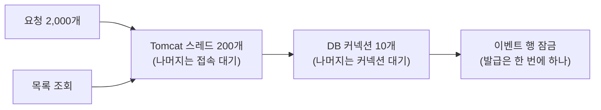

# 13장. 심화: 가상 스레드와 몰림 대응

> 한 줄 요약: 스레드 제한을 풀면 "기다리는 요청"이 다른 곳으로 옮겨 갈 뿐 사라지지 않는다. 그 줄이 어디에 서는지 정하는 것이 몰림 대응이다.

이 장은 M5(몰림 대응)에서 실제로 겪은 일을 따라갑니다. 계획은 세 줄이었습니다. 조회 힌트 고치기, 발급 동시 실행 제한, 가상 스레드 켜기. 하지만 부하 테스트를 돌릴 때마다 예상하지 못한 문제가 하나씩 나왔고, 그것을 고친 과정이 이 장의 대부분입니다.

## 1. 문제 — 몰림이 다른 기능까지 느리게 한다

M4 의 즉시 발급(원자적 UPDATE)에 2,000명이 몰리는 동안, 다른 사용자가 **이벤트 목록**(DB 를 읽는 평범한 API)을 초당 50번 불렀습니다.

| | 발급 응답 p95 | 같은 시간 목록 조회 p95 |
|---|---|---|
| M4 | 2.3~16.3초 | **1.9~17.0초** |

목록 조회는 쿠폰과 상관이 없는데, 발급과 똑같이 느려졌습니다. 줄이 두 군데 생기기 때문입니다.



1. **스레드 줄**: Tomcat 은 요청 하나에 스레드 하나를 붙입니다. 200개가 다 차면 목록 조회도 스레드를 기다립니다.
2. **커넥션 줄**: 원자적 UPDATE 는 행 잠금을 기다리는 동안 DB 커넥션을 쥡니다. 10개가 다 차면 목록 조회도 커넥션을 기다립니다.

행 잠금 때문에 발급은 어차피 한 번에 하나씩 진행됩니다. 커넥션을 10개 쥐어도 발급은 빨라지지 않고, 다른 API 만 굶습니다.

## 2. 개념

### 가상 스레드 (Java 21)

플랫폼 스레드는 운영체제 스레드와 1:1 입니다. 메모리를 많이 쓰고 만들기 비싸서 풀(pool)에 수백 개만 둡니다.
가상 스레드는 JVM 이 관리하는 가벼운 스레드입니다. 실제 실행은 소수의 운영체제 스레드(**캐리어**, 기본은 코어 수만큼) 위에 올라가서 합니다.

| 상황 | 플랫폼 스레드 | 가상 스레드 |
|---|---|---|
| DB·Redis 응답을 기다림 | 운영체제 스레드를 쥔 채 기다림 | 캐리어에서 내려옴(unmount). 캐리어는 다른 가상 스레드를 돌림 |
| 동시에 기다리는 요청 수 | 스레드 수(200)가 상한 | 사실상 상한 없음 |
| `synchronized` 안에서 기다림 (JDK 21) | 그대로 기다림 | **캐리어를 쥔 채 기다림(고정, pinning)** |

마지막 줄이 이 장의 핵심 사고로 이어집니다. JDK 24(JEP 491)부터는 `synchronized` 에서도 캐리어를 놓지만, 이 프로젝트는 JDK 21 입니다.

### 격벽(bulkhead)

배 안을 여러 칸으로 나눠 두면 한 칸에 물이 차도 배가 가라앉지 않습니다. 자원도 같습니다. **한 기능이 쓸 수 있는 몫을 정해 두면**, 그 기능이 몰려도 나머지 기능은 자기 몫을 씁니다.
이 프로젝트에서는 "발급은 DB 커넥션을 최대 5개까지만" 이 격벽입니다.

## 3. 프로젝트 코드로 보기

### 가상 스레드 켜기

[application.properties](../src/main/resources/application.properties#L9-L11)

```properties
# 가상 스레드(Java 21): 요청 스레드가 Redis·DB 응답을 기다리는 동안 운영체제 스레드를 내려놓는다. 몰림에서 Tomcat 스레드 200개라는 상한이 사라진다.
# 상한이 사라진 만큼 DB 커넥션 앞에 더 많은 요청이 몰리므로, 발급은 동시 실행 제한(coupon.issue.bulkhead)과 함께 쓴다.
spring.threads.virtual.enabled=true
```

설정 한 줄이면 Tomcat 의 요청 처리가 가상 스레드로 바뀝니다. 그런데 이 한 줄이 스케줄러도 바꿉니다.

### 함정 1 — 스케줄러가 스레드 하나로 줄어든다

[SchedulingConfig.kt](../src/main/kotlin/com/site/infrastructure/async/SchedulingConfig.kt#L9-L23)

```kotlin
@Configuration
@EnableScheduling
class SchedulingConfig {

    /**
     * 가상 스레드를 켜도 스케줄러는 플랫폼 스레드 풀(spring.task.scheduling.pool.size)로 둔다.
     *
     * spring.threads.virtual.enabled=true 이면 스프링 부트는 SimpleAsyncTaskScheduler 를 쓰는데,
     * 이 스케줄러는 fixed-delay 작업을 "스레드 하나"에서 차례로 돌린다. (fixed-delay 의미를 지키려고. spring-context 6.2 javadoc)
     * 대기열 워커·알림 Outbox·SSE 스케줄러가 모두 fixed-delay 라서, 알림 발송(외부 API)이 느려지면 대기열 워커까지 밀린다.
     * TaskScheduler 빈을 직접 등록하면 스프링 부트의 자동 설정은 물러난다.
     */
    @Bean
    fun taskScheduler(builder: ThreadPoolTaskSchedulerBuilder): ThreadPoolTaskScheduler = builder.build()
}
```

가상 스레드를 켜면 스프링 부트는 `SimpleAsyncTaskScheduler` 를 씁니다. 이 스케줄러는 **fixed-delay 작업을 스레드 하나에서 차례로** 돌립니다. 스프링 소스의 javadoc 에 그렇게 적혀 있습니다.
이 프로젝트의 대기열 워커(200ms), 알림 Outbox, SSE 스케줄러는 모두 fixed-delay 입니다. 그대로 두면 알림 발송(외부 API)이 느려질 때 대기열 워커까지 밀립니다. 그래서 `TaskScheduler` 빈을 직접 등록해 스레드 3개짜리 풀로 고정했습니다.

> 설정 한 줄을 바꿀 때는 그 설정이 **무엇을 더 바꾸는지** 문서와 소스로 확인하세요. 이 함정은 켜기 전에 spring-context 소스를 읽다가 찾았습니다.

### 발급 동시 실행 제한

[CouponIssueBulkhead.kt](../src/main/kotlin/com/site/domain/coupon/service/CouponIssueBulkhead.kt#L11-L48)

```kotlin
/**
 * 즉시 발급 단계의 동시 실행 수를 제한한다. (bulkhead — 배의 격벽처럼, 한 칸에 물이 차도 다른 칸은 지킨다)
 *
 * 원자적 UPDATE 는 모든 발급이 이벤트 한 행의 잠금에 줄을 서고, 줄을 서는 동안 DB 커넥션을 쥔다.
 * 행 잠금 때문에 발급은 어차피 하나씩 진행되므로 커넥션을 많이 쥐어도 빨라지지 않고, 같은 풀을 쓰는 다른 API 만 커넥션을 못 얻는다.
 * 그래서 발급은 커넥션을 최대 maxConcurrent 개까지만 쓰게 하고, 나머지 요청은 커넥션 없이 여기서 기다리게 한다.
 * 커넥션 풀을 둘로 나누는 것과 같은 효과를, 데이터소스를 하나 더 만들지 않고 얻는다.
 *
 * - 공정(fair) 모드: 먼저 기다린 요청이 먼저 들어간다. 비공정 모드는 막 도착한 요청이 비는 자리를 가로챌 수 있다. (선착순의 새치기)
 * - 서버마다 따로 센다. 서버가 N 대면 DB 전체로는 N × maxConcurrent 개까지 쓴다.
 */
@Component
class CouponIssueBulkhead(
    properties: CouponIssueProperties,
    private val meterRegistry: MeterRegistry,
) {

    init {
        require(properties.bulkhead.maxConcurrent > 0) { "maxConcurrent must be positive: ${properties.bulkhead.maxConcurrent}" }
    }

    private val permits = Semaphore(properties.bulkhead.maxConcurrent, true)
    private val maxWaitMillis = properties.bulkhead.maxWait.toMillis()

    fun <T> execute(action: () -> T): T {
        val waitStartedAt = System.nanoTime()
        val acquired = permits.tryAcquire(maxWaitMillis, TimeUnit.MILLISECONDS)
        recordWait(acquired, System.nanoTime() - waitStartedAt)
        if (!acquired) {
            throw ServiceException(ErrorCode.COUPON_ISSUE_BUSY)
        }

        try {
            return action()
        } finally {
            permits.release()
        }
    }
```

- `Semaphore(5, true)`: 자리 5개. 두 번째 인자 `true` 는 **공정 모드**로, 먼저 기다린 요청이 먼저 들어갑니다. 선착순 서비스라서 새치기를 막아야 합니다.
- `tryAcquire(maxWait)`: 자리를 정해진 시간까지만 기다립니다. 넘기면 503 으로 "잠시 후 다시" 를 알립니다.
- 커넥션 풀을 진짜로 둘로 나누려면 데이터소스와 트랜잭션 매니저가 둘이 되어야 합니다. "발급이 동시에 5개 넘게 들어가지 않게"만 해도 같은 효과가 납니다.

이 제한은 즉시 발급의 입구에서 씁니다.

[CouponIssueFacade.kt](../src/main/kotlin/com/site/domain/coupon/service/CouponIssueFacade.kt#L33-L50)

```kotlin
    fun issue(couponEventId: Long, memberId: Long): IssuedCoupon =
        try {
            startedCouponEvents.checkIssuable(couponEventId, CouponIssueMode.DIRECT)
            bulkhead.execute {
                // 자리를 기다리는 사이에 소진됐을 수 있다. 메모리에서 다시 확인해, 소진 뒤 줄은 DB 를 거치지 않고 바로 빠지게 한다
                startedCouponEvents.checkIssuable(couponEventId, CouponIssueMode.DIRECT)
                when (properties.directStrategy) {
                    DirectIssueStrategy.ATOMIC_UPDATE -> couponIssueService.issueWithAtomicUpdate(couponEventId, memberId, CouponIssueMode.DIRECT)
                    DirectIssueStrategy.DISTRIBUTED_LOCK -> couponIssueService.issueWithDistributedLock(couponEventId, memberId)
                }
            }.also { metrics.recordDirectIssued() }
        } catch (e: ServiceException) {
            if (e.errorCode == ErrorCode.COUPON_SOLD_OUT) {
                startedCouponEvents.markSoldOut(couponEventId)
            }
            metrics.recordDirectFailed(e.errorCode)
            throw e
        }
```

자리를 얻은 뒤 `checkIssuable` 을 **한 번 더** 부르는 이유는 5절의 사고 4에서 나옵니다.

### 캐시 첫 로드 — single-flight

[StartedCouponEventCache.kt](../src/main/kotlin/com/site/domain/coupon/service/StartedCouponEventCache.kt#L57-L87)

```kotlin
    /**
     * 같은 이벤트를 동시에 처음 요청하면 한 요청만 DB 를 읽고, 나머지는 그 결과를 기다린다. (single-flight)
     *
     * 오픈 순간에는 캐시가 비어 있어서, 동시에 들어온 요청이 각자 DB 를 읽으면 그 수만큼 커넥션 풀에 줄을 선다.
     * 가상 스레드에서는 스레드 수 제한이 없어 수천 개가 한꺼번에 몰린다. (부하 테스트에서 커넥션 대기 1,416)
     *
     * computeIfAbsent 로 하지 않은 이유: 읽는 동안 같은 칸의 다른 스레드를 synchronized 로 막는데,
     * JDK 21 가상 스레드는 synchronized 에서 기다리는 동안 캐리어(운영체제 스레드)를 놓지 못한다.
     * CompletableFuture 를 기다리는 것은 일반 park 라서 캐리어를 놓는다.
     */
    private fun loadOnce(couponEventId: Long, now: LocalDateTime): StartedCouponEvent {
        val mine = CompletableFuture<StartedCouponEvent>()
        loading.putIfAbsent(couponEventId, mine)?.let { inFlight -> return awaitLoad(inFlight) }

        try {
            return load(couponEventId, now).also { mine.complete(it) }
        } catch (e: Exception) {
            mine.completeExceptionally(e)
            throw e
        } finally {
            loading.remove(couponEventId, mine)
        }
    }

    /** 다른 요청이 읽은 결과를 기다린다. 그 요청이 실패했다면(없는 이벤트 등) 같은 예외를 던진다 */
    private fun awaitLoad(inFlight: CompletableFuture<StartedCouponEvent>): StartedCouponEvent =
        try {
            inFlight.join()
        } catch (e: CompletionException) {
            throw e.cause ?: e
        }
```

같은 이벤트를 처음 읽는 요청이 여럿이면, 맨 앞 요청만 DB 를 읽고 나머지는 그 `CompletableFuture` 를 기다립니다. 5절의 사고 3 에서 왜 필요했는지 봅니다.

## 4. 왜 둘 다 필요한가

가상 스레드와 동시 실행 제한을 하나씩만 켜면 줄이 다른 곳으로 옮겨 갈 뿐입니다. 같은 앱(jar)을 설정만 바꿔 띄우고, 1,000장에 2,000~5,000명이 몰리는 동안 목록 조회를 초당 50번 불렀습니다.

| 목록 조회 p95 | 플랫폼 스레드 | 가상 스레드 |
|---|---|---|
| **제한 없음** | 1.9~17.0초 (M4) | 2.7~3.8초 · DB 커넥션 대기 631~1,079 |
| **발급 5개로 제한** | 3.2~5.4초 · Tomcat 스레드에서 막힘 | **11ms~1.45초** |

- 가상 스레드만: 스레드 줄은 사라졌지만, 수천 개 요청이 한꺼번에 커넥션 풀로 가서 **커넥션 줄**이 길어집니다.
- 제한만: 커넥션은 지켰지만, 자리를 기다리는 발급 요청이 Tomcat 스레드 200개를 차지해서 **스레드 줄**에 목록 조회가 섭니다.
- 둘 다: 발급 요청은 가상 스레드로 메모리에서 기다리고, 커넥션은 5개만 씁니다. 목록 조회는 남은 커넥션과 새 가상 스레드로 바로 처리됩니다.

## 5. 사고 기록 — 부하 테스트가 찾아 준 것들

### 사고 1. 테스트가 갑자기 몇 배 느려졌다

가상 스레드를 켜자 동시성 테스트가 몇 배 느려졌습니다(원자적 UPDATE 443ms → 9.8초). 가상 스레드 탓처럼 보였지만, 설정만 바꿔 번갈아 돌리니 **기계 부하 평균이 60**(10코어)이었던 시간에만 느렸습니다. 부하가 내려간 뒤에는 켠 채로도 평소와 같았습니다.

> 측정 전에는 `uptime` 으로 부하부터 봅니다. "바꾼 것"과 "바뀐 결과" 사이에 다른 원인이 끼어 있을 수 있습니다.

### 사고 2. 앱이 멈췄다 — 고정(pinning) 교착

가상 스레드를 켠 앱에 2,000명을 몰았더니 요청을 **1초에 1건**만 처리했고, 종료 신호를 보내도 7분 넘게 내려가지 않았습니다.

일반 `jstack` 은 가상 스레드를 보여 주지 않습니다. 가상 스레드까지 덤프하려면 이렇게 합니다.

```bash
jcmd <pid> Thread.dump_to_file -format=text dump.txt
```

| 덤프에서 본 것 | 뜻 |
|---|---|
| 가상 스레드 9개가 Tomcat `ConnectionHandler.unregister` 의 `synchronized (this)` 앞에서 대기 | `synchronized` 에서 기다리는 가상 스레드는 캐리어를 놓지 못한다 (JDK 21) |
| 캐리어(코어 수 10개)가 이렇게 묶임 | 다른 가상 스레드를 돌릴 운영체제 스레드가 없다 |
| 가상 스레드 1,003개가 아무 프레임 없이 대기 | 캐리어를 못 얻어 시작도 못 한 요청들 |
| 종료 훅이 로그 출력 락을 기다림. 락의 주인은 `jstack` 에 안 보임 | 락을 쥔 가상 스레드도 캐리어를 못 얻어 멈췄다 |

그 `synchronized` 블록은 Tomcat 이 연결마다 **MBean 을 등록·해제**하는 코드였고, `server.tomcat.mbeanregistry.enabled=true` 일 때만 실행됩니다. M3 에서 Tomcat 스레드 지표를 보려고 켠 설정입니다. 플랫폼 스레드에서는 잠깐 줄을 서고 끝나던 코드가, 가상 스레드에서는 캐리어를 묶어 앱 전체를 멈춥니다.

[application.properties](../src/main/resources/application.properties#L20-L22)

```properties
# Tomcat MBean 등록은 끈다 (기본값). 켜면 연결마다 MBean 을 등록·해제하는데, 그 코드가 synchronized 안에서 JMX 서버를 기다려
# 가상 스레드가 운영체제 스레드에 고정(pinning)된다. 가상 스레드에서는 Tomcat 스레드 풀 지표도 의미가 없어서,
# 요청이 얼마나 몰렸는지는 처리 중인 요청 수(http_server_requests_active_seconds_gcount)로 본다.
```

설정을 끄자 같은 부하에서 고정이 0건이 되었습니다. `-Djdk.tracePinnedThreads=short` 로 띄우면 고정이 일어날 때마다 로그에 스택이 남습니다. 가상 스레드를 켜기 전에 이 옵션으로 부하 테스트를 한 번 돌려 보세요.

### 사고 3. 대기열이 DB 커넥션을 1,416개 기다렸다

대기열 줄 서기는 Redis 만 씁니다. 그런데 가상 스레드를 켠 실험에서 **DB 커넥션 대기가 1,416** 까지 쌓이고, 결과까지 시간이 몇 배로 늘었습니다.

원인은 캐시 첫 로드였습니다. 오픈 순간 캐시가 비어 있으면 동시에 들어온 요청이 각자 DB 를 읽습니다. 플랫폼 스레드일 때는 스레드 200개가 그 수를 묶어 줬는데, 가상 스레드에서는 **수천 개가 한꺼번에** 읽으러 갔습니다. 그 줄 뒤에서 대기열 워커도 커넥션을 기다렸습니다.

single-flight 로 고친 뒤, 같은 실험의 커넥션 대기는 0 이 되었습니다.

`ConcurrentHashMap.computeIfAbsent` 를 쓰면 더 짧게 쓸 수 있지만, 계산하는 동안 같은 칸의 다른 스레드를 `synchronized` 로 막습니다. 사고 2와 같은 종류의 고정입니다. `CompletableFuture.join()` 은 일반 park 라서 캐리어를 놓습니다.

> 스레드 수 제한은 성능의 적이기만 한 것이 아니었습니다. **몰래 입장 제어(admission control)를 해 주고 있었습니다.** 그 제한을 풀면, 그동안 가려져 있던 약한 곳이 먼저 무너집니다.

### 사고 4. 쿠폰이 남았는데 503 이 났다

동시 실행 제한의 대기 한도를 처음에는 5초로 잡았습니다. 1,000장에 5,000명을 몰았더니 503 이 대량으로 났습니다.

| 원인 | 고친 방법 |
|---|---|
| 줄을 서 있는 사이에 소진돼도, 자리를 얻은 뒤 DB 에 가서야 소진을 알았다. 소진 뒤 줄이 천천히 빠졌다 | 자리를 얻은 직후 메모리 캐시로 **다시 확인** (소진 뒤 503: 444명 → 0명) |
| 공정 모드라 줄 선 순서대로 발급되는데, 느린 환경에서는 1,000장을 다 주는 데 5초가 넘게 걸렸다 | 대기 한도를 **30초**로. 제한을 넣기 전에도 DB 커넥션을 최대 30초(HikariCP 기본값) 기다렸다 |

플랫폼 스레드일 때는 넘친 요청이 Tomcat 바깥(접속 대기열)에서 기다려서 이 한도에 걸리지 않았습니다. 가상 스레드에서는 모든 요청이 앱 안으로 들어와 이 줄에 섭니다. 여기서도 "줄이 어디에 서는가"가 바뀌었습니다.

## 6. 그래서 빨라졌나

솔직하게 말하면, **이 실험 환경에서는 발급 속도와 대기열 처리 속도를 판단할 수 없었습니다.**
k6(가상 사용자 최대 5,000명)·앱·MySQL·Redis 가 노트북 한 대의 CPU 와 메모리를 나눠 썼고, 같은 M4 를 두 번 재도 즉시 발급 응답이 3.6초와 13.0초로 갈렸습니다. 기계 부하 평균은 측정 중에 5에서 106 사이를 오갔습니다.

이 정도로 흔들리는 환경에서도 결론이 같은 방향으로 나온 것만 믿을 수 있습니다.

| 확실한 것 | 근거 |
|---|---|
| 다른 API 를 지키려면 가상 스레드 + 동시 실행 제한이 함께 필요하다 | 모든 회차에서 목록 조회 p95: 둘 다일 때 11ms~1.45초, 하나만이거나 없을 때 1.9~17초 |
| 고정 교착은 MBean 등록을 끄면 사라진다 | 끈 뒤 모든 회차에서 고정 0건 |
| single-flight 가 커넥션 몰림을 없앤다 | 대기열 실험 커넥션 대기 1,416 → 0 |

반대로, 가상 스레드가 **발급 자체를 빠르게 하지는 않았습니다.** CPU 가 병목인 상황에서는 동시에 도는 요청이 늘수록 각자의 몫이 줄어듭니다. 가상 스레드는 "기다리는 비용"을 줄여 줄 뿐, CPU 를 늘려 주지 않습니다.

## 흔한 실수

- **가상 스레드를 켜면 빨라진다고 기대한다.** 기다림이 많은 I/O 위주 서비스에서 동시 처리량이 늘 뿐입니다. CPU 가 바쁘면 효과가 없거나 나빠집니다.
- **`synchronized` 를 신경 쓰지 않는다.** JDK 21 에서는 `synchronized` 안에서 기다리는 코드 하나가 캐리어를 묶습니다. 라이브러리 안에 있어도 마찬가지입니다(이번에는 Tomcat).
- **스레드 풀이 해 주던 일을 잊는다.** 스레드 200개 제한은 DB 커넥션 앞의 줄 길이도 묶어 주고 있었습니다. 제한을 풀면 그 줄을 다른 곳(격벽)에서 직접 관리해야 합니다.
- **대기 한도를 감으로 정한다.** 줄 선 순서대로 처리되는 곳에서 한도가 짧으면, 받을 수 있었던 사람이 503 을 받습니다.
- **흔들리는 환경에서 한 번 재고 결론 낸다.** 같은 것을 두 번 재서 얼마나 흔들리는지부터 봅니다.

## 직접 해보기

1. `CouponIssueBulkhead` 를 비공정 모드(`Semaphore(5, false)`)로 바꾸면 무엇이 달라질까요? 선착순 서비스에서 어떤 불만이 나올지 생각해 보세요.
2. `StartedCouponEventCache.loadOnce` 를 `computeIfAbsent` 로 바꾸고, 가상 스레드를 켠 상태에서 `-Djdk.tracePinnedThreads=short` 로 부하 테스트를 돌려 보세요. 로그에 무엇이 남나요?
3. 서버를 3대로 늘리면 동시 실행 제한 5개는 DB 전체로 몇 개가 되나요? 커넥션 풀 크기와 함께 어떻게 정해야 할까요?
4. `-Djdk.tracePinnedThreads=short` 를 켜고 앱을 띄운 뒤, 일부러 `server.tomcat.mbeanregistry.enabled=true` 로 몰림을 만들어 보세요. 덤프(`jcmd ... Thread.dump_to_file`)에서 캐리어가 묶이는 모습을 찾아보세요. (로컬에서만!)

**힌트**

1. 막 도착한 요청이 자리를 가로챌 수 있어서, 먼저 줄 선 사람보다 늦게 온 사람이 먼저 발급받을 수 있습니다. 처리량은 조금 늘 수 있습니다.
2. `ConcurrentHashMap.computeIfAbsent` → `synchronized` 에서 기다리는 가상 스레드의 스택이 찍힙니다. 첫 로드가 느릴수록 많이 찍힙니다.
3. 3 × 5 = 15 개. DB 의 `max_connections` 와 서버마다의 풀 크기(10)를 넘지 않게, 그리고 다른 API 몫이 남게 정합니다.
4. 9개 안팎의 가상 스레드가 `ConnectionHandler.unregister` 에 멈춰 있고, 수많은 가상 스레드가 프레임 없이 대기합니다.

## 다음으로

[README](README.md) 로 돌아가 다른 장을 다시 보거나, [load-test/README.md](../load-test/README.md) 에서 M5 측정 표 전체를 보세요.
