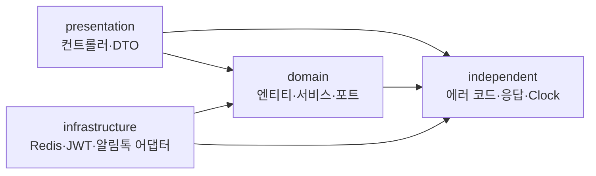

# 코프링 교재 — 선착순 쿠폰으로 배우는 Kotlin + Spring Boot

이 교재는 이 저장소(Kopring_Core)의 **실제 코드**로 Kotlin 과 Spring Boot 를 배웁니다.
문법을 따로 외우지 않고, "선착순 쿠폰을 1,000명이 동시에 누르면 어떻게 되나" 같은 질문을 따라가며 필요한 개념을 하나씩 꺼냅니다.

## 누구를 위한 교재인가

- 프로그래밍은 해 봤지만 Kotlin 은 처음이거나 거의 모르는 사람
- Java·Spring 을 조금 써 봤거나, 전혀 몰라도 괜찮습니다. 필요한 Spring 개념은 장마다 처음부터 설명합니다.
- 이 저장소를 직접 열어 보면서 읽는 것을 전제로 합니다. 코드 인용 아래의 링크를 눌러 원본 파일을 함께 보세요.

## 읽는 법

장마다 같은 순서로 구성했습니다.

| 순서 | 내용 |
|---|---|
| 한 줄 요약 | 이 장에서 가져갈 것 하나 |
| 개념 | 처음 보는 사람을 위한 설명 |
| 프로젝트 코드로 보기 | 저장소 코드를 그대로 옮긴 인용 + 원본 링크 |
| 왜 이렇게 했나 / 흔한 실수 | 코드 주석·커밋·부하 테스트에 남은 설계 판단 |
| 직접 해보기 | 2~4개의 연습 문제 (힌트는 [12장](12-next-steps-and-exercises.md)) |

- 코드 블록 위에 링크가 붙어 있으면 **저장소 코드를 그대로 옮긴 것**입니다.
- 저장소에 없는 코드는 `// 예시` 라고 표시했습니다.
- 인용은 M6(코드 리뷰 정리)까지 끝난 코드 기준입니다. 코드가 바뀌면 링크 쪽이 최신입니다.

## 목차

| 장 | 제목 | 이 장의 질문 | 주로 보는 코드 |
|---|---|---|---|
| 1 | [Kotlin 기초](01-kotlin-basics.md) | 자바 개발자가 Kotlin 에서 처음 막히는 곳은? | `CouponEvent`, `EnqueueResult`, `JwtAuthenticationFilter` |
| 2 | [스프링이 Kotlin 을 만나면](02-spring-meets-kotlin.md) | Kotlin 으로 Spring 을 쓰려면 무엇을 더 해야 하나? | `build.gradle.kts`, `*Properties` |
| 3 | [프로젝트 구조와 계층](03-architecture.md) | 코드를 어디에 두고, 누가 누구를 알아야 하나? | `CouponQueueStore`, `AlimtalkSender`, `LayerDependencyTest` |
| 4 | [JPA 엔티티를 Kotlin 으로](04-jpa-with-kotlin.md) | DB 테이블을 Kotlin 클래스로 어떻게 옮기나? | `CouponEvent`, `IssuedCoupon`, Flyway |
| 5 | [웹 계층과 예외 처리](05-web-and-errors.md) | 요청을 받고, 검증하고, 에러를 어떻게 돌려주나? | `CouponController`, `ErrorCode`, `GlobalExceptionHandler` |
| 6 | [인증](06-auth.md) | 로그인은 어떻게 유지되고, 훔친 토큰은 어떻게 막나? | `SecurityConfig`, `JwtTokenProvider`, `AuthService` |
| 7 | [동시성 제어](07-concurrency.md) | 100장짜리 쿠폰을 300명이 동시에 누르면? | `CouponIssueService`, `DistributedLockAspect` |
| 8 | [비동기와 신뢰성](08-async-and-reliability.md) | 발급 알림을 "반드시 한 번은" 보내려면? | `NotificationOutbox*` |
| 9 | [Redis 대기열](09-redis-queue.md) | DB 를 지키면서 줄 선 순서대로 나눠 주려면? | `RedisCouponQueueStore`, `CouponQueueWorker` |
| 10 | [테스트](10-testing.md) | 시간·동시성·외부 API 가 얽힌 코드를 어떻게 검증하나? | Kotest, MockK, Testcontainers |
| 11 | [관측과 부하 테스트](11-observability-and-load-test.md) | "빨라졌다"를 숫자로 말하려면? | Micrometer, Prometheus, k6 |
| 12 | [다음 공부와 연습 문제](12-next-steps-and-exercises.md) | 여기서 어디로 가나? (연습 문제 힌트 포함) | — |
| 13 | [심화: 가상 스레드와 몰림 대응](13-virtual-threads-and-backpressure.md) | 스레드 제한을 풀면 빨라질까? 무엇이 대신 무너지나? | `CouponIssueBulkhead`, `SchedulingConfig`, `StartedCouponEventCache` |

**읽는 순서 추천**

- 빠른 길(하루): 1장 → 3장 → 7장 → 9장
- 처음부터(일주일): 1장부터 차례로. 4장과 7장은 코드를 직접 돌려 보며 읽으세요.

## 프로젝트 지도

선착순 쿠폰 발급 시스템입니다. 관리자가 "100장 한정 5천원 할인" 같은 이벤트를 만들고, 회원이 시작 시각에 몰려와 쿠폰을 받습니다.
받는 방식은 두 가지입니다.

| 방식 | 흐름 | 장점 | 대가 |
|---|---|---|---|
| 즉시 발급 `DIRECT` | 요청 → 사전 검사 → DB 발급 → 응답 | 결과를 바로 안다 | 몰리면 DB 커넥션이 먼저 찬다 |
| 대기열 `QUEUE` | 요청 → Redis 에 줄 서기 → 202 응답 → 워커가 차례로 발급 | DB 부하가 워커 속도로 고정 | 결과를 나중에 안다 |

### 패키지 구조

```
src/main/kotlin/com/site
├── SiteApplication.kt          애플리케이션 시작점
├── domain/                     비즈니스 규칙. 기술(Redis·JWT·알림톡)을 모른다
│   ├── auth/                   로그인·토큰 재발급·로그아웃 (port = 토큰 저장소 인터페이스)
│   ├── common/entity/          생성·수정 시각을 가진 공통 엔티티
│   ├── coupon/
│   │   ├── entity/             CouponEvent, IssuedCoupon, Discount, EventPeriod ...
│   │   ├── event/              CouponIssuedEvent (발급됐다는 사실)
│   │   ├── queue/              대기열 서비스·워커·조회 간격 정책 (port = 대기열 저장소 인터페이스)
│   │   ├── repository/         Spring Data JPA 리포지토리
│   │   └── service/            발급(동시성 제어), 이벤트 관리, 내 쿠폰, 사전 검사 캐시
│   ├── member/                 회원
│   └── notification/           알림 Outbox (port = 알림톡 발송 인터페이스)
├── infrastructure/             domain 의 포트를 구현하는 기술 어댑터
│   ├── async/                  @Async 스레드 풀, @Scheduled 활성화
│   ├── biztalk/                알림톡 발송 (Solapi / 로그 대체)
│   ├── database/               JPA Auditing, 로컬 관리자 계정
│   ├── redis/                  분산락, 대기열, refresh token, 블랙리스트
│   ├── security/               Spring Security, JWT
│   └── swagger/                API 문서
├── presentation/               HTTP 입구 (컨트롤러, 요청·응답 DTO, SSE)
└── independent/                어느 계층에도 기대지 않는 공통 코드 (에러 코드, 응답 형식, Clock ...)
```



화살표는 "안다(import 한다)"는 뜻입니다. domain 은 아무 계층도 알지 않고, infrastructure 가 domain 의 인터페이스를 구현합니다. ([3장](03-architecture.md))

### API 한눈에

| 메서드 · 경로 | 하는 일 | 권한 |
|---|---|---|
| `POST /api/members` | 회원가입 | 누구나 |
| `POST /api/auth/login` · `/reissue` · `/logout` | 로그인, 토큰 재발급, 로그아웃 | 누구나 / 로그아웃은 로그인 필요 |
| `GET /api/members/me` | 내 정보 | 로그인 |
| `POST·GET·PUT·DELETE /api/admin/coupon-events` | 이벤트 등록·조회·수정·삭제 | ADMIN |
| `GET /api/coupon-events` | 진행 중·예정 이벤트 목록 | 로그인 |
| `POST /api/coupon-events/{id}/issue` | 즉시 발급 | 로그인 |
| `POST /api/coupon-events/{id}/queue` | 대기열 등록 (202) | 로그인 |
| `GET /api/coupon-events/{id}/queue/me` · `/queue/me/stream` | 내 대기열 상태 (조회 / SSE) | 로그인 |
| `GET /api/members/me/coupons` · `POST .../{id}/use` | 내 쿠폰 목록, 쿠폰 사용 | 로그인 |

## 로컬에서 돌려 보기

필요한 것: JDK 21, Docker.

```bash
docker compose up -d        # MySQL 8.4(3306) + Redis 7.4(6380)
./gradlew bootRun           # local 프로필로 실행 (http://localhost:8080)
```

- API 문서: http://localhost:8080/swagger-ui/index.html — 우측 상단 Authorize 에 access token 을 넣습니다.
- 관리자 계정: 기동할 때 자동으로 만들어집니다. `admin@kopring.local` / `admin1234!` ([LocalAdminInitializer.kt](../src/main/kotlin/com/site/infrastructure/database/LocalAdminInitializer.kt))
- 테이블은 Flyway 가 만듭니다. 직접 만들 필요가 없습니다. ([4장](04-jpa-with-kotlin.md))

```bash
./gradlew test              # 테스트 (Testcontainers 가 MySQL·Redis 를 Docker 로 띄운다)
./gradlew ktlintCheck       # 코드 스타일 검사 (CI 와 같은 조건)
docker compose --profile monitoring up -d   # Prometheus(9090)·Grafana(3000) 까지
```

부하 테스트 실행법과 결과는 [load-test/README.md](../load-test/README.md) 에 있습니다. ([11장](11-observability-and-load-test.md))

## 용어

| 용어 | 뜻 |
|---|---|
| 이벤트 (`CouponEvent`) | "100장 한정 5천원 할인" 같은 쿠폰 발급 행사 |
| 발급 (`IssuedCoupon`) | 회원 한 명이 받은 쿠폰 한 장 |
| 소진 (`SOLD_OUT`) | 진행 기간이지만 수량을 다 나눠 준 상태 |
| 포트 / 어댑터 | domain 이 정한 인터페이스 / 그것을 Redis·JWT 등으로 구현한 클래스 |
| 사전 검사 (fast-fail) | 어차피 실패할 요청을 락이나 DB 앞에서 먼저 돌려보내는 것 |
| Outbox | "보낼 알림"을 비즈니스 변경과 같은 트랜잭션에 기록해 두는 테이블 |
| lease | "이 작업은 내가 처리 중"이라고 잡아 두는 만료 시각. 지나면 남이 가져간다 |
